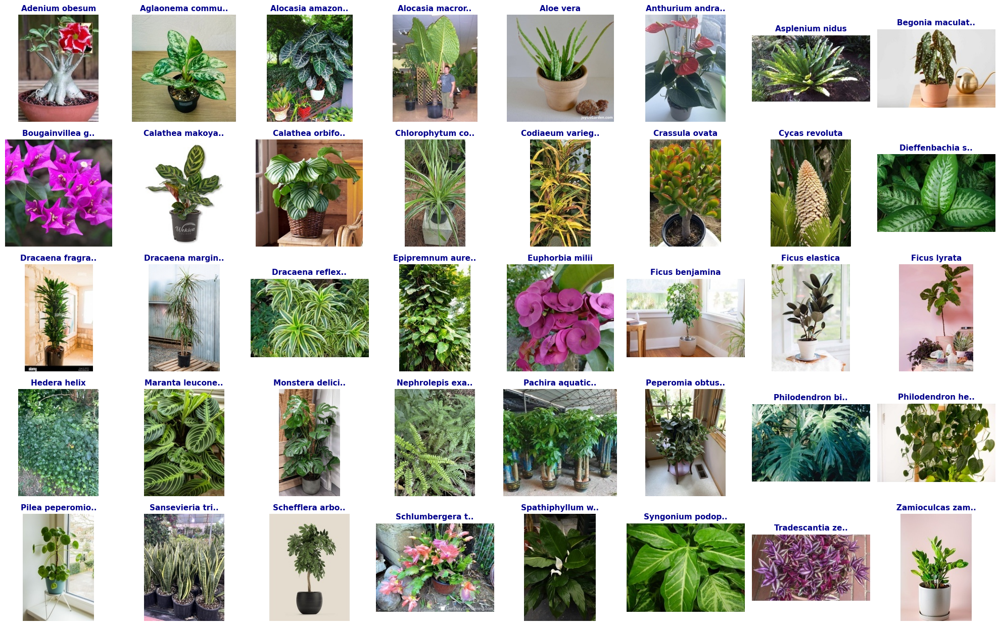
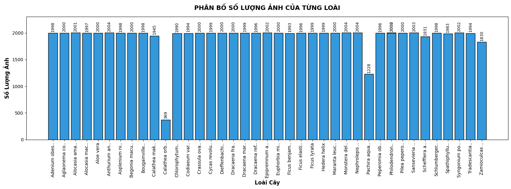
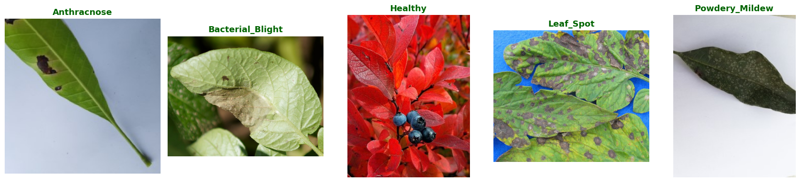
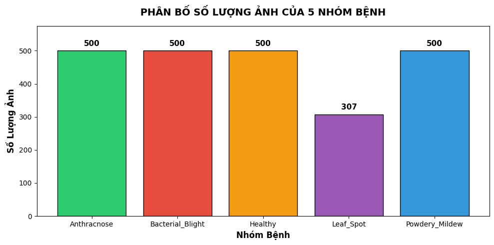
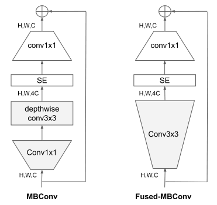
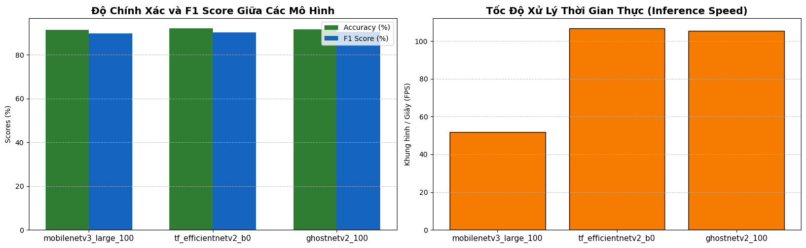

<!-- ==================== TRANG BÌA NGOÀI ==================== -->

**TRƯỜNG ĐẠI HỌC VINH**  
**TRƯỜNG KỸ THUẬT VÀ CÔNG NGHỆ**

---

**TRẦN NGỌC HẢI**

**ĐỒ ÁN TỐT NGHIỆP ĐẠI HỌC**  
**NGÀNH CÔNG NGHỆ THÔNG TIN**

# NGHIÊN CỨU VÀ XÂY DỰNG HỆ THỐNG NHẬN DIỆN, CHẨN ĐOÁN BỆNH VÀ HỖ TRỢ CHĂM SÓC CÂY CẢNH ỨNG DỤNG HỌC SÂU

**Nghệ An, [Tháng/2026]**

---

<!-- ==================== TRANG BÌA LÓT (TRANG PHỤ BÌA) ==================== -->

**TRƯỜNG ĐẠI HỌC VINH**  
**TRƯỜNG KỸ THUẬT VÀ CÔNG NGHỆ**  
**KHOA CÔNG NGHỆ THÔNG TIN**

---

**ĐỒ ÁN TỐT NGHIỆP ĐẠI HỌC**  
**NGÀNH CÔNG NGHỆ THÔNG TIN**

# NGHIÊN CỨU VÀ XÂY DỰNG HỆ THỐNG NHẬN DIỆN, CHẨN ĐOÁN BỆNH VÀ HỖ TRỢ CHĂM SÓC CÂY CẢNH ỨNG DỤNG HỌC SÂU

| | |
| :--- | :--- |
| **Giảng viên hướng dẫn:** | `[Học hàm, Học vị – Họ và tên GVHD]` |
| **Sinh viên thực hiện:** | Trần Ngọc Hải |
| **Mã sinh viên:** | 225748020110069 |
| **Lớp:** | `[Lớp – Khóa]` |

**Nghệ An, [Tháng/2026]**

---

# LỜI CAM ĐOAN

Tôi xin cam đoan rằng tất cả các nội dung, số liệu thực nghiệm và kết quả trình bày trong đồ án tốt nghiệp với đề tài *“Nghiên cứu và xây dựng hệ thống nhận diện, chẩn đoán bệnh và hỗ trợ chăm sóc cây cảnh ứng dụng Học sâu”* là sản phẩm nghiên cứu và quá trình làm việc nghiêm túc của bản thân tôi dưới sự hướng dẫn tận tình của `[Học hàm, Học vị – Họ và tên GVHD]`.

Mọi tài liệu tham khảo, bộ dữ liệu công khai, thư viện mã nguồn mở và các ý kiến trích dẫn trong báo cáo đều được ghi rõ nguồn gốc, minh bạch theo đúng quy định của Trường Đại học Vinh. Tôi cam kết không sao chép trái phép công trình của bất kỳ cá nhân hay tổ chức nào và hoàn toàn chịu trách nhiệm trước Hội đồng về tính chính xác, trung thực của những nội dung đã trình bày trong đồ án này.

*Nghệ An, ngày ... tháng ... năm 2026*  
**Sinh viên thực hiện**  
Trần Ngọc Hải

---

# LỜI CẢM ƠN

Lời đầu tiên, em xin bày tỏ lòng biết ơn sâu sắc tới Ban Giám hiệu Trường Đại học Vinh, Trường Kỹ thuật và Công nghệ cùng toàn thể quý Thầy, Cô Khoa Công nghệ Thông tin đã tận tâm giảng dạy, trang bị cho em nền tảng kiến thức vững chắc về Trí tuệ nhân tạo và Công nghệ phần mềm trong suốt thời gian học tập tại trường.

Đặc biệt, em xin gửi lời cảm ơn chân thành và sâu sắc nhất tới `[Học hàm, Học vị – Họ và tên GVHD]`, người đã trực tiếp hướng dẫn, định hướng hướng nghiên cứu, góp ý chi tiết về mặt kiến trúc hệ thống cũng như động viên, tạo điều kiện giúp em vượt qua những khó khăn kỹ thuật để hoàn thành đồ án tốt nghiệp này.

Cuối cùng, em xin gửi lời cảm ơn tới gia đình và bạn bè đã luôn đồng hành, cổ vũ tinh thần và hỗ trợ thử nghiệm ứng dụng trong thực tế. Do giới hạn về thời gian và kinh nghiệm thực tiễn, báo cáo khó tránh khỏi những thiếu sót; em rất mong nhận được những ý kiến nhận xét, đóng góp quý báu từ quý Thầy, Cô để đề tài được hoàn thiện hơn.

Em xin chân thành cảm ơn!

*Nghệ An, ngày ... tháng ... năm 2026*  
**Sinh viên thực hiện**  
Trần Ngọc Hải

---

# DANH MỤC CÁC HÌNH

- **Hình 0.1.** Giao diện ứng dụng PictureThis
- **Hình 0.2.** Giao diện ứng dụng Planta
- **Hình 0.3.** Giao diện ứng dụng PlantNet
- **Hình 1.1.** Ảnh mẫu đại diện của 40 loài cây cảnh trong bộ dữ liệu
- **Hình 1.2.** Biểu đồ phân bố số lượng mẫu ảnh theo từng loài trong bộ dữ liệu 40 loài cây
- **Hình 1.3.** Ảnh mẫu đại diện của 5 nhóm trạng thái bệnh lá trong bộ dữ liệu
- **Hình 1.4.** Biểu đồ phân bố số lượng ảnh của 5 nhóm trạng thái bệnh lá
- **Hình 1.5.** Cấu trúc khối MBConv và Fused-MBConv trong kiến trúc EfficientNetV2
- **Hình 1.6.** Cấu trúc khối GhostNetV1, GhostNetV2 và mô-đun DFC Attention
- **Hình 1.7.** Cấu trúc khối cơ bản của kiến trúc MobileNetV3
- **Hình 1.8.** Biểu đồ biến thiên hàm mất mát của EfficientNetV2 B0 (40 loài cây)
- **Hình 1.9.** Biểu đồ biến thiên độ chính xác của EfficientNetV2 B0 (40 loài cây)
- **Hình 1.10.** Đường cong ROC của 5 lớp đầu tiên trên EfficientNetV2 B0 (40 loài cây)
- **Hình 1.11.** Ma trận nhầm lẫn của EfficientNetV2 B0 trên tập kiểm tra 40 loài cây
- **Hình 1.12.** So sánh tổng hợp Accuracy, F1-Score và tốc độ FPS giữa ba mô hình nhận diện 40 loài cây
- **Hình 1.13.** So sánh Accuracy, F1-Score và tốc độ FPS giữa ba mô hình trên bài toán chẩn đoán 5 nhóm bệnh lá
- **Hình 1.14.** Biểu đồ biến thiên hàm mất mát của EfficientNetV2 B0 nhóm bệnh lá
- **Hình 1.15.** Biểu đồ biến thiên độ chính xác của EfficientNetV2 B0 nhóm bệnh lá
- **Hình 1.16.** Đường cong ROC của EfficientNetV2 B0 trên nhóm bệnh lá
- **Hình 1.17.** Ma trận nhầm lẫn của EfficientNetV2 B0 trên tập kiểm tra nhóm bệnh lá
- **Hình 1.18.** Sơ đồ luồng suy luận đa tầng của hệ thống AI
- **Hình 2.1.** Biểu đồ ca sử dụng của khách hàng
- **Hình 2.2.** Biểu đồ ca sử dụng của nhân viên vận hành
- **Hình 2.3.** Biểu đồ ca sử dụng của chuyên gia thực vật
- **Hình 2.4.** Biểu đồ ca sử dụng của quản trị viên hệ thống
- **Hình 2.5.** Biểu đồ tuần tự chức năng đăng ký
- **Hình 2.6.** Biểu đồ tuần tự chức năng đăng nhập
- **Hình 2.7.** Biểu đồ tuần tự chức năng đăng xuất
- **Hình 2.8.** Biểu đồ tuần tự chức năng nhận diện loài cây và chẩn đoán bệnh
- **Hình 2.9.** Biểu đồ tuần tự chức năng quản lý khu vườn cá nhân
- **Hình 2.10.** Biểu đồ tuần tự chức năng tương tác trợ lý ảo AI
- **Hình 2.11.** Biểu đồ tuần tự chức năng đặt hàng và thanh toán
- **Hình 2.12.** Biểu đồ tuần tự chức năng quản lý đơn hàng
- **Hình 2.13.** Biểu đồ tuần tự chức năng quản lý sản phẩm và kho hàng
- **Hình 2.14.** Biểu đồ tuần tự chức năng quản lý từ điển thực vật và bệnh học
- **Hình 2.15.** Biểu đồ tuần tự chức năng duyệt nhãn dữ liệu AI Lab
- **Hình 2.16.** Biểu đồ tuần tự chức năng quản lý người dùng và phân quyền
- **Hình 2.17.** Biểu đồ phân lớp

---

# DANH MỤC CÁC BẢNG

- **Bảng 1.1.** Tổng hợp thông số kỹ thuật và quy mô phân chia bộ dữ liệu 40 loài cây cảnh
- **Bảng 1.2.** Thống kê mô tả và phân bổ bộ dữ liệu chẩn đoán 5 nhóm bệnh lá
- **Bảng 1.3.** Tổng hợp kết quả đánh giá ba mô hình trên bài toán nhận diện 40 loài cây cảnh
- **Bảng 1.4.** Tổng hợp kết quả đánh giá ba mô hình trên bài toán chẩn đoán 5 nhóm bệnh lá
- **Bảng 2.1.** Mô tả chi tiết chức năng đăng ký
- **Bảng 2.2.** Mô tả chi tiết chức năng đăng nhập
- **Bảng 2.3.** Mô tả chi tiết chức năng đăng xuất
- **Bảng 2.4.** Mô tả chi tiết chức năng nhận diện cây và chẩn đoán bệnh
- **Bảng 2.5.** Mô tả chi tiết chức năng quản lý vườn và lịch chăm sóc
- **Bảng 2.6.** Mô tả chi tiết chức năng tương tác trợ lý ảo AI
- **Bảng 2.7.** Mô tả chi tiết chức năng đặt hàng và thanh toán
- **Bảng 2.8.** Mô tả chi tiết chức năng quản lý đơn hàng
- **Bảng 2.9.** Mô tả chi tiết chức năng quản lý sản phẩm và kho hàng
- **Bảng 2.10.** Mô tả chi tiết chức năng quản lý từ điển thực vật và bệnh học
- **Bảng 2.11.** Mô tả chi tiết chức năng duyệt nhãn dữ liệu AI Lab
- **Bảng 2.12.** Mô tả chi tiết chức năng quản lý người dùng và phân quyền
- **Bảng 2.13.** Bảng cơ sở dữ liệu người dùng (Users)
- **Bảng 2.14.** Bảng thông tin cây cảnh (plants_info)
- **Bảng 2.15.** Bảng hồ sơ bệnh học thực vật (DiseasesInfo)
- **Bảng 2.16.** Bảng lịch sử quét (ScanHistory)
- **Bảng 2.17.** Bảng cây trong vườn cá nhân (MyGarden)
- **Bảng 2.18.** Bảng nhật ký sinh trưởng (DiaryNotes)
- **Bảng 2.19.** Bảng phiên trò chuyện AI (ChatSessions)
- **Bảng 2.20.** Bảng thông tin sản phẩm (ShopProducts)
- **Bảng 2.21.** Bảng đơn đặt hàng (Orders)
- **Bảng 2.22.** Bảng cẩm nang chăm sóc (PlantHandbook)

---

# DANH MỤC CÁC TỪ VIẾT TẮT

| Từ viết tắt | Tiếng Anh đầy đủ | Nghĩa tiếng Việt |
| :--- | :--- | :--- |
| **AI** | Artificial Intelligence | Trí tuệ nhân tạo |
| **API** | Application Programming Interface | Giao diện lập trình ứng dụng |
| **CDN** | Content Delivery Network | Mạng phân phối nội dung |
| **CNN** | Convolutional Neural Network | Mạng nơ-ron tích chập |
| **CLIP** | Contrastive Language–Image Pretraining | Mô hình học tương phản ngôn ngữ – hình ảnh |
| **CRUD** | Create, Read, Update, Delete | Tạo, Đọc, Cập nhật, Xóa |
| **DL** | Deep Learning | Học sâu |
| **FCM** | Firebase Cloud Messaging | Dịch vụ thông báo đẩy Firebase |
| **FPS** | Frames Per Second | Số khung hình / mẫu xử lý trên giây |
| **GPU** | Graphics Processing Unit | Bộ xử lý đồ họa |
| **JWT** | JSON Web Token | Mã định danh phiên xác thực dạng JSON |
| **LLM** | Large Language Model | Mô hình ngôn ngữ lớn |
| **NoSQL** | Not Only SQL | Cơ sở dữ liệu phi quan hệ |
| **ONNX** | Open Neural Network Exchange | Định dạng chuẩn trao đổi mô hình mạng nơ-ron mở |
| **RBAC** | Role-Based Access Control | Kiểm soát truy cập dựa trên vai trò |
| **REST** | Representational State Transfer | Kiến trúc chuẩn giao tiếp web API |
| **RGB** | Red, Green, Blue | Không gian màu Đỏ – Lục – Lam |
| **UI / UX** | User Interface / User Experience | Giao diện người dùng / Trải nghiệm người dùng |
| **UML** | Unified Modeling Language | Ngôn ngữ mô hình hóa thống nhất |

---

# MỤC LỤC

- [LỜI CAM ĐOAN](#lời-cam-đoan)
- [LỜI CẢM ƠN](#lời-cảm-ơn)
- [DANH MỤC CÁC HÌNH](#danh-mục-các-hình)
- [DANH MỤC CÁC BẢNG](#danh-mục-các-bảng)
- [DANH MỤC CÁC TỪ VIẾT TẮT](#danh-mục-các-từ-viết-tắt)
- [MỞ ĐẦU](#mở-đầu)
  - [1. Lý do chọn đề tài và bài toán đặt ra](#1-lý-do-chọn-đề-tài-và-bài-toán-đặt-ra)
  - [2. Khảo sát nghiệp vụ các hệ thống liên quan](#2-khảo-sát-nghiệp-vụ-các-hệ-thống-liên-quan)
  - [3. Mục đích thực hiện và hình thành ý tưởng hệ thống](#3-mục-đích-thực-hiện-và-hình-thành-ý-tưởng-hệ-thống)
  - [4. Đối tượng và phạm vi nghiên cứu](#4-đối-tượng-và-phạm-vi-nghiên-cứu)
  - [5. Nội dung và phương pháp thực hiện](#5-nội-dung-và-phương-pháp-thực-hiện)
  - [6. Cấu trúc của đồ án](#6-cấu-trúc-của-đồ-án)
- [CHƯƠNG 1. NGHIÊN CỨU, HUẤN LUYỆN VÀ ĐÁNH GIÁ MÔ HÌNH HỌC SÂU](#chương-1-nghiên-cứu-huấn-luyện-và-đánh-giá-mô-hình-học-sâu)
  - [1.1. Phát biểu bài toán và hướng tiếp cận](#11-phát-biểu-bài-toán-và-hướng-tiếp-cận)
  - [1.2. Thu thập, chuẩn bị và trực quan hóa dữ liệu](#12-thu-thập-chuẩn-bị-và-trực-quan-hóa-dữ-liệu)
  - [1.3. Cơ sở lý thuyết các kiến trúc học sâu sử dụng](#13-cơ-sở-lý-thuyết-các-kiến-trúc-học-sâu-sử-dụng)
  - [1.4. Cài đặt và quy trình huấn luyện mô hình](#14-cài-đặt-và-quy-trình-huấn-luyện-mô-hình)
  - [1.5. Thực nghiệm, đánh giá và lựa chọn mô hình](#15-thực-nghiệm-đánh-giá-và-lựa-chọn-mô-hình)
- [CHƯƠNG 2. PHÂN TÍCH VÀ THIẾT KẾ HỆ THỐNG](#chương-2-phân-tích-và-thiết-kế-hệ-thống)
  - [2.1. Phân tích hệ thống nhận diện và chăm sóc cây cảnh](#21-phân-tích-hệ-thống-nhận-diện-và-chăm-sóc-cây-cảnh)
  - [2.2. Tổng quan các chức năng của hệ thống](#22-tổng-quan-các-chức-năng-của-hệ-thống)
    - [2.2.1. Chức năng đăng ký, đăng nhập, đăng xuất hệ thống](#221-chức-năng-đăng-ký-đăng-nhập-đăng-xuất-hệ-thống)
    - [2.2.2. Chức năng dành cho khách hàng](#222-chức-năng-dành-cho-khách-hàng)
    - [2.2.3. Chức năng dành cho nhân viên vận hành & CSKH](#223-chức-năng-dành-cho-nhân-viên-vận-hành--cskh)
    - [2.2.4. Chức năng dành cho chuyên gia thực vật](#224-chức-năng-dành-cho-chuyên-gia-thực-vật)
    - [2.2.5. Chức năng dành cho quản trị viên hệ thống](#225-chức-năng-dành-cho-quản-trị-viên-hệ-thống)
  - [2.3. Thiết kế cơ sở dữ liệu](#23-thiết-kế-cơ-sở-dữ-liệu)
    - [2.3.1. Biểu đồ lớp của bài toán](#231-biểu-đồ-lớp-của-bài-toán)
    - [2.3.2. Cơ sở dữ liệu](#232-cơ-sở-dữ-liệu)
      - [2.3.2.1. Bảng người dùng](#2321-bảng-người-dùng)
      - [2.3.2.2. Bảng từ điển cây cảnh](#2322-bảng-từ-điển-cây-cảnh)
      - [2.3.2.3. Bảng hồ sơ bệnh học](#2323-bảng-hồ-sơ-bệnh-học)
      - [2.3.2.4. Bảng lịch sử nhận diện và chẩn đoán](#2324-bảng-lịch-sử-nhận-diện-và-chẩn-đoán)
      - [2.3.2.5. Bảng cây trồng trong vườn cá nhân](#2325-bảng-cây-trồng-trong-vườn-cá-nhân)
      - [2.3.2.6. Bảng nhật ký sinh trưởng cây trồng](#2326-bảng-nhật-ký-sinh-trưởng-cây-trồng)
      - [2.3.2.7. Bảng phiên tương tác trợ lý ảo AI](#2327-bảng-phiên-tương-tác-trợ-lý-ảo-ai)
      - [2.3.2.8. Bảng sản phẩm vật tư](#2328-bảng-sản-phẩm-vật-tư)
      - [2.3.2.9. Bảng đơn đặt hàng](#2329-bảng-đơn-đặt-hàng)
      - [2.3.2.10. Bảng bài viết cẩm nang chăm sóc](#23210-bảng-bài-viết-cẩm-nang-chăm-sóc)
- [TÀI LIỆU THAM KHẢO](#tài-liệu-tham-khảo)

---

# MỞ ĐẦU

## 1. Lý do chọn đề tài và bài toán đặt ra

Trong đời sống hiện đại, đặc biệt tại các khu vực đô thị, nhu cầu trồng và chăm sóc cây cảnh nội thất, cây ban công ngày càng gia tăng mạnh mẽ. Cây xanh không chỉ giúp cải thiện thẩm mỹ không gian sống, thanh lọc không khí mà còn góp phần cân bằng tinh thần và giảm căng thẳng cho con người. Tuy nhiên, phần lớn người yêu thích cây cảnh không được đào tạo chuyên sâu về sinh học thực vật hay nông học, dẫn đến nhiều khó khăn thực tế trong quá trình nuôi dưỡng và bảo vệ cây:

* **Khó khăn trong việc nhận diện chính xác loài cây:** Nhiều loài cây cảnh thuộc cùng một họ thực vật (như họ Ráy *Araceae*, họ Đuôi công *Marantaceae*, họ Dâu tằm *Moraceae*) có hình dáng lá và màu sắc khá tương đồng. Việc xác định sai loài dẫn đến áp dụng sai chế độ ánh sáng, lượng nước tưới hoặc loại giá thể, làm cây còi cọc hoặc chết úng.
* **Khó phát hiện sớm và điều trị đúng bệnh lý trên lá:** Các bệnh lý phổ biến như thán thư (*Anthracnose*), đốm lá nấm (*Leaf Spot*), cháy bìa lá vi khuẩn (*Bacterial Blight*) hay phấn trắng (*Powdery Mildew*) thường có biểu hiện ban đầu dễ bị bỏ qua hoặc chẩn đoán nhầm với hiện tượng cháy nắng, thiếu dinh dưỡng thông thường. Nếu không được cách ly và xử lý đúng phác đồ, mầm bệnh có thể lây lan nhanh chóng sang các chậu cây khác.
* **Thiếu công cụ quản lý tập trung và đồng bộ:** Việc ghi nhớ lịch tưới nước, bón phân, lau lá cho hàng chục chậu cây theo từng điều kiện thời tiết khác nhau bằng phương pháp thủ công rất dễ bị gián đoạn và thiếu chính xác.

Trong khi đó, sự bùng nổ của Trí tuệ nhân tạo (AI), đặc biệt là các mạng Học sâu (Deep Learning) trong Thị giác máy tính cùng các Mô hình Ngôn ngữ lớn (LLM), cho phép tự động trích xuất đặc trưng thị giác từ ảnh chụp điện thoại để nhận diện loài cây và chẩn đoán bệnh lá chỉ trong vài trăm mili-giây. Kết hợp sức mạnh AI đó với kiến trúc dịch vụ web hiện đại, ứng dụng di động và cổng quản trị web sẽ tạo ra một hệ sinh thái chăm sóc cây trồng thông minh, khép kín và dễ tiếp cận đối với mọi người dùng.

Xuất phát từ nhu cầu thực tiễn và giá trị công nghệ đó, đề tài **“Nghiên cứu và xây dựng hệ thống nhận diện, chẩn đoán bệnh và hỗ trợ chăm sóc cây cảnh ứng dụng Học sâu”** đã được lựa chọn thực hiện. Đề tài không chỉ giải quyết bài toán nghiên cứu, tối ưu mô hình học sâu nhận diện hình ảnh mà còn hiện thực hóa thành một hệ thống phần mềm hoàn chỉnh vận hành trên cả thiết bị di động lẫn nền tảng web.

## 2. Khảo sát nghiệp vụ và các hệ thống liên quan

### 2.1. Khảo sát mô hình hoạt động và quy trình nghiệp vụ trên thị trường

Khảo sát thực tế trong lĩnh vực cây cảnh đô thị hiện nay cho thấy mối quan hệ giữa các chủ thể và quy trình chăm sóc chủ yếu diễn ra theo phương thức thủ công:

* **Mô hình hoạt động thực tế:**
  * *Người trồng cây:* Tự chăm sóc tại nhà hoặc văn phòng, thiếu kiến thức sinh học chuyên sâu và thường dựa vào cảm tính hoặc kinh nghiệm truyền miệng trên mạng xã hội.
  * *Nhà vườn, cửa hàng vật tư:* Cung cấp cây giống, phân bón và thuốc nhưng tư vấn chủ yếu theo kinh nghiệm cá nhân, thiếu phác đồ chuẩn hóa khoa học.
  * *Chuyên gia nông học:* Nắm vững tri thức bệnh học thực vật nhưng thiếu kênh công nghệ kết nối trực tiếp đến đông đảo người trồng cây cảnh đô thị.

* **Quy trình nghiệp vụ thực tế:**
  1. *Nhận diện & tra cứu:* Tra cứu thủ công qua hình ảnh hoặc mô tả trên mạng xã hội, dễ nhầm lẫn giữa các loài có hình thái tương đồng.
  2. *Chăm sóc định kỳ:* Ghi nhớ lịch tưới nước, bón phân thủ công, không thích ứng kịp thời với thay đổi thời tiết dẫn đến cây dễ bị úng rễ hoặc khô héo.
  3. *Chẩn đoán bệnh lý:* Chụp ảnh đăng hỏi triệu chứng trên các hội nhóm; phản hồi thường chậm trễ và thiếu kiểm chứng khiến mầm bệnh dễ lây lan.
  4. *Mua sắm vật tư:* Tự tìm mua thuốc điều trị nhưng thiếu sự liên kết trực tiếp với bệnh án cụ thể, dễ dùng sai loại hoặc pha sai nồng độ.

### 2.2. Khảo sát một số ứng dụng liên quan đến đề tài

Để học hỏi kinh nghiệm thiết kế giao diện, luồng xử lý AI và xác định điểm khác biệt cho hệ thống xây dựng, quá trình khảo sát tập trung vào ba ứng dụng nhận diện và chăm sóc thực vật phổ biến hiện nay:

* **PictureThis:** Là một trong những ứng dụng nhận diện thực vật có độ phổ biến cao trên toàn cầu, nổi bật với khả năng nhận diện nhanh tên loài hoa, cây cảnh và cảnh báo một số sâu bệnh cơ bản (như minh họa ở Hình 0.1). Giao diện trực quan, luồng chụp ảnh đơn giản. Tuy nhiên, phần lớn nội dung chuyên sâu và tính năng chẩn đoán bệnh bị khóa sau gói trả phí định kỳ (Subscription), dữ liệu bản địa hóa tiếng Việt còn hạn chế và chưa tích hợp hệ sinh thái mua sắm vật tư đặc trị gắn với bệnh án.

  `[Chèn ảnh chụp giao diện ứng dụng PictureThis]`  
  *Hình 0.1. Giao diện ứng dụng PictureThis*

* **Planta:** Tập trung mạnh vào chức năng quản lý khu vườn trong nhà và lập lịch tưới nước, bón phân, chuyển chậu dựa trên loại cây và vị trí ánh sáng trong phòng (Hình 0.2). Ưu điểm của Planta là trải nghiệm nhắc việc chi tiết và phân loại theo không gian sống. Hạn chế của ứng dụng là chưa chú trọng sâu vào chẩn đoán bệnh lý lá qua ảnh chụp và thiếu trợ lý hội thoại AI tương tác trực tiếp bằng tiếng Việt theo ngữ cảnh từng chậu cây.

  `[Chèn ảnh chụp giao diện ứng dụng Planta]`  
  *Hình 0.2. Giao diện ứng dụng Planta*

* **PlantNet:** Là dự án khoa học công dân cho phép nhận diện hàng chục nghìn loài thực vật tự nhiên dựa trên ảnh lá, hoa, quả với độ tin cậy học thuật cao và hoàn toàn miễn phí (Hình 0.3). Tuy nhiên, PlantNet thiên về mục đích tra cứu phân loại học thực vật hoang dã, không cung cấp các tính năng quản lý vườn cá nhân, nhắc lịch chăm sóc, chẩn đoán bệnh lý hay tư vấn điều trị cho người trồng cây cảnh.

  `[Chèn ảnh chụp giao diện ứng dụng PlantNet]`  
  *Hình 0.3. Giao diện ứng dụng PlantNet*

| Tiêu chí so sánh | PictureThis | Planta | PlantNet | Hệ thống đề xuất (Đề tài) |
| :--- | :--- :---: | :---: | :---: | :---: |
| Nhận diện loài cây từ ảnh | Có | Hạn chế | Rất tốt (Thực vật học) | **Có (40 loài chuyên sâu + LLM mở rộng)** |
| Chẩn đoán bệnh lý trên lá & phác đồ | Có (Trả phí) | Hạn chế | Không | **Có (5 nhóm bệnh cốt lõi + phác đồ chi tiết)** |
| Lọc ảnh không phải thực vật | Cơ bản | Không | Cơ bản | **Có (Mô hình CLIP + kiểm tra độ sáng)** |
| Quản lý vườn & lịch chăm sóc theo thời tiết | Có (Trả phí) | Rất tốt | Không | **Có (Đồng bộ dữ liệu thời tiết thời gian thực)** |
| Trợ lý AI hội thoại theo ngữ cảnh cây | Không | Không | Không | **Có (Trợ lý tư vấn LLM theo ngữ cảnh)** |
| Cửa hàng vật tư & Cổng Web Quản trị | Không | Không | Không | **Có (App + Web User/Admin dùng chung CSDL)** |

*Bảng 0.1. Bảng so sánh hệ thống đề xuất với các ứng dụng liên quan*

Qua khảo sát cho thấy, người dùng tại Việt Nam rất cần một hệ thống thuần Việt, miễn phí các tính năng cốt lõi, kết nối liền mạch từ **nhận diện & chẩn đoán bệnh bằng AI** $\rightarrow$ **theo dõi chăm sóc tại vườn** $\rightarrow$ **tư vấn & cung ứng vật tư**, đồng thời có **nền tảng quản trị web** cho phép người vận hành cập nhật tri thức thực vật và xử lý đơn hàng linh hoạt.

## 3. Mục đích thực hiện và hình thành ý tưởng hệ thống

### 3.1. Mục đích thực hiện

* **Nghiên cứu và làm chủ mô hình Học sâu:** Thu thập, chuẩn hóa dữ liệu và thực nghiệm so sánh các kiến trúc mạng nhẹ (EfficientNetV2, GhostNetV2, MobileNetV3) cho hai bài toán nhận diện loài cây và chẩn đoán bệnh lá, từ đó chọn mô hình tối ưu nhất xuất sang ONNX.
* **Xây dựng hệ thống đồng bộ, mở rộng cao:** Thiết kế kiến trúc Microservices tách biệt dịch vụ suy luận AI (FastAPI), máy chủ điều phối nghiệp vụ (Spring Boot) và cơ sở dữ liệu đám mây (Cloud Firestore), đảm bảo bảo mật xác thực.
* **Phát triển sản phẩm đa nền tảng hoàn chỉnh:** Xây dựng ứng dụng di động (Flutter) kết hợp cổng Web dành cho Người dùng và Quản trị viên (Next.js) đáp ứng trọn vẹn nhu cầu nhận diện, chăm sóc cây và mua sắm trực tuyến.

### 3.2. Hình thành ý tưởng thiết kế hệ thống

Hệ thống được tổ chức thành 4 khối chức năng liên kết chặt chẽ:

1. **Khối Trí tuệ nhân tạo đa tầng:** Kết hợp bộ lọc tiền kiểm duyệt bằng **mô hình CLIP** (loại bỏ ảnh tối hoặc ảnh không phải thực vật), hai mô hình học sâu chuyên biệt (nhận diện 40 loài cây và chẩn đoán 5 nhóm bệnh) cùng **mô hình LLM** hỗ trợ mở rộng nhận diện các loài cây nằm ngoài danh mục.
2. **Khối Quản lý khu vườn & Chăm sóc thông minh:** Quản lý hồ sơ cây theo từng không gian vườn, tự động nhắc lịch tưới nước – bón phân – lau lá theo thời tiết thực tế và lưu nhật ký sinh trưởng.
3. **Khối Trợ lý AI & Thương mại vật tư:** Trợ lý ảo tư vấn theo ngữ cảnh từng chậu cây, đề xuất áp dụng lịch chăm sóc 1 chạm và gợi ý sản phẩm đặc trị gắn với giỏ hàng, thanh toán trực tuyến hoặc tiền mặt khi nhận hàng (COD).
4. **Khối Cổng Web User & Admin:** Dùng chung dữ liệu Cloud Firestore và dịch vụ máy chủ trung tâm, hỗ trợ người dùng thao tác trên trình duyệt và giúp đội ngũ quản trị cập nhật từ điển cây, bệnh lý, sản phẩm, đơn hàng, cẩm nang theo thời gian thực.

## 4. Các yêu cầu phi chức năng

Để đảm bảo chất lượng và khả năng vận hành ổn định, hệ thống cần đáp ứng các yêu cầu phi chức năng sau:

- Hệ thống cần có hiệu năng tốt, đảm bảo tốc độ phản hồi nhanh khi quét nhận diện cây, chẩn đoán bệnh lá và tải dữ liệu ngay cả khi nhiều người dùng truy cập đồng thời.
- Tính bảo mật phải được đảm bảo nhằm bảo vệ thông tin tài khoản và dữ liệu người dùng thông qua cơ chế xác thực an toàn cùng phân quyền hợp lý.
- Giao diện ứng dụng cần được thiết kế thân thiện, trực quan và dễ sử dụng, giúp người dùng dễ dàng thao tác nhận diện cây, theo dõi chăm sóc và mua sắm vật tư.
- Hệ thống phải có khả năng mở rộng để đáp ứng sự gia tăng về số lượng người dùng, dữ liệu cây trồng và giao dịch mà vẫn duy trì hiệu suất ổn định.
- Tính tin cậy và an toàn dữ liệu cần được chú trọng thông qua cơ chế đồng bộ thời gian thực và sao lưu định kỳ để hạn chế rủi ro mất mát dữ liệu.
- Ứng dụng cần tương thích với nhiều thiết bị di động và trình duyệt web khác nhau, có cấu trúc mã nguồn rõ ràng, dễ bảo trì và nâng cấp trong tương lai.

## 5. Cấu trúc của đồ án

Nội dung đồ án gồm phần Mở đầu, Kết luận, Tài liệu tham khảo và **3 chương**:

* **Chương 1. Nghiên cứu, huấn luyện và đánh giá mô hình học sâu:** Trình bày cơ sở lý thuyết, dữ liệu, huấn luyện mô hình nhận diện loài, chẩn đoán bệnh lá và luồng suy luận đa tầng.
* **Chương 2. Phân tích và thiết kế hệ thống:** Đặc tả yêu cầu, thiết kế kiến trúc tổng thể, các biểu đồ UML và cơ sở dữ liệu Cloud Firestore.
* **Chương 3. Triển khai và đánh giá hệ thống:** Cài đặt ứng dụng di động, cổng Web, máy chủ dịch vụ và kết quả thử nghiệm thực tế.

---

# CHƯƠNG 1. NGHIÊN CỨU, HUẤN LUYỆN VÀ ĐÁNH GIÁ MÔ HÌNH HỌC SÂU

Trong kiến trúc tổng thể của hệ thống hỗ trợ chăm sóc cây cảnh thông minh, tầng Trí tuệ nhân tạo giữ vai trò hạt nhân khi trực tiếp tiếp nhận hình ảnh thực tế từ người dùng để phân tích, nhận diện loài thực vật và phát hiện sớm các dấu hiệu bệnh lý trên lá. Độ chính xác, khả năng chống nhiễu cũng như tốc độ phản hồi của mô hình học sâu ở tầng này quyết định trực tiếp đến chất lượng tư vấn sinh thái học, phác đồ điều trị và trải nghiệm tương tác trên cả ứng dụng di động lẫn nền tảng web.

Chương 1 trình bày toàn bộ quá trình nghiên cứu, xây dựng và đánh giá các mô hình học sâu phục vụ hai bài toán phân loại ảnh chuyên biệt gồm nhận diện các loài cây cảnh phổ biến và chẩn đoán các trạng thái bệnh lý trên lá thường gặp. Nội dung chương đi từ việc phát biểu bài toán và những thách thức của ảnh chụp thực tế; quy trình thu thập, làm sạch, trực quan hóa hai bộ dữ liệu thực nghiệm quy mô lớn; tìm hiểu cơ sở lý thuyết các kiến trúc mạng gọn nhẹ hiện đại (*EfficientNetV2, GhostNetV2, MobileNetV3*), bộ lọc đa phương thức *CLIP* và chuẩn thực thi *ONNX*; đến thiết lập đường ống huấn luyện cân bằng lớp. Cuối chương, các mô hình được đánh giá đối chứng qua nhiều thước đo định lượng để lựa chọn mô hình tối ưu nhất, kết hợp thiết kế luồng suy luận đa tầng sẵn sàng đưa vào tích hợp ở các chương tiếp theo.

## 1.1. Phát biểu bài toán và hướng tiếp cận

Để xây dựng mô hình trí tuệ nhân tạo có khả năng vận hành ổn định trong môi trường thực tế, việc xác định chính xác dạng bài toán, đầu vào – đầu ra cũng như các yếu tố nhiễu đặc trưng của ảnh thực vật là bước nền tảng đầu tiên. Phần này trình bày phát biểu toán học cho hai nhiệm vụ phân loại cốt lõi cùng chiến lược tiếp cận tổng thể nhằm giải quyết đồng thời yêu cầu về độ chính xác và tốc độ phản hồi.

### 1.1.1. Phát biểu bài toán phân loại ảnh thực vật

Dưới góc độ Thị giác máy tính, cả hai nhiệm vụ nhận diện loài cây và chẩn đoán bệnh lá đều thuộc lớp bài toán **phân lớp hình ảnh đa lớp (Multi-class Image Classification)**. Cho một hình ảnh màu đầu vào $I \in \mathbb{R}^{H \times W \times 3}$ (không gian màu RGB) được chụp từ camera điện thoại hoặc tải lên từ trình duyệt, mô hình học sâu cần học một hàm ánh xạ $f_\theta$ để dự đoán phân phối xác suất $\hat{y} = (\hat{y}_1, \hat{y}_2, \dots, \hat{y}_K)$ thuộc về $K$ nhãn mục tiêu:

$$\hat{y} = f_\theta(I)$$

Trong đó:
* $I \in \mathbb{R}^{H \times W \times 3}$ là ảnh đầu vào không gian màu RGB kích thước $H \times W$.
* $f_\theta$ là hàm ánh xạ của mạng nơ-ron học sâu với bộ trọng số $\theta$.
* $K$ là số lớp mục tiêu cần phân loại ($K \ge 2$).
* $\hat{y}_i \in [0, 1]$ là xác suất ảnh $I$ thuộc về lớp thứ $i$, thỏa mãn $\sum_{i=1}^{K} \hat{y}_i = 1$.

Lớp dự đoán cuối cùng $\hat{c}$ được chọn theo xác suất lớn nhất: $\hat{c} = \arg\max_{i} \hat{y}_i$.

Cụ thể, đề tài tập trung giải quyết hai bài toán phân loại hình ảnh chuyên biệt:
* **Bài toán 1 – Nhận diện phân loại loài cây cảnh:** Xác định danh tính loài thực vật từ hình ảnh chụp tổng thể hoặc tán lá cây trồng trong không gian sống (nội thất, ban công, sân vườn) nhằm hỗ trợ người dùng định danh chính xác và liên kết trực tiếp với cơ sở tri thức chăm sóc sinh thái học.
* **Bài toán 2 – Chẩn đoán tình trạng bệnh lý trên lá:** Phân tích ảnh chụp cận cảnh bề mặt phiến lá để phát hiện sớm các dấu hiệu tổn thương bệnh học hoặc xác nhận trạng thái khỏe mạnh của cây, cung cấp cơ sở khoa học để đưa ra phác đồ điều trị kịp thời.

### 1.1.2. Thách thức thực tế và hướng tiếp cận giải pháp

Ảnh chụp thực tế từ người dùng thường gặp nhiều thách thức: ánh sáng thay đổi phức tạp, phông nền lộn xộn, ảnh chụp nhầm không phải thực vật hoặc quá tối, và đặc biệt là rào cản của **bài toán phân loại thế giới đóng (*Closed-set Classification*)**: mô hình học sâu truyền thống chỉ có thể phân loại trong phạm vi các nhãn đã được định nghĩa trước trong không gian huấn luyện. Khi người dùng cung cấp hình ảnh của các loài cây nằm ngoài danh mục đã học, mô hình dễ bị gượng ép gán nhãn vào một trong các lớp có sẵn với độ tự tin ảo, gây sai lệch thông tin nghiêm trọng.

Để giải quyết các thách thức trên và tối ưu tốc độ phản hồi cho hệ thống thực tế, đề tài áp dụng các hướng tiếp cận chính sau:

1. **Học chuyển giao (Transfer Learning):** Kế thừa trọng số tiền huấn luyện từ tập dữ liệu quy mô lớn ImageNet trên các kiến trúc tích chập gọn nhẹ, sau đó tinh chỉnh (*fine-tuning*) trên dữ liệu thực vật nhằm tối ưu độ chính xác và tiết kiệm tài nguyên tính toán.
2. **Tiền kiểm duyệt đầu vào đa tầng:** Kiểm tra độ tương phản để lọc ảnh kém chất lượng và sử dụng mô hình thị giác – ngôn ngữ **CLIP** [4] theo cơ chế Zero-shot nhằm nhận biết, loại bỏ sớm ảnh quá tối hoặc ảnh không phải thực vật trước khi đưa vào phân loại sâu.
3. **Kết hợp mô hình LLM đa phương thức và tối ưu hóa ONNX:** Sử dụng mô hình ngôn ngữ lớn đa phương thức (Multimodal LLM) để nhận diện mở rộng các loài thực vật tự nhiên trong thế giới mở; đồng thời tối ưu hóa mô hình học sâu chuyên biệt sang chuẩn **ONNX** nhằm đạt tốc độ suy luận cao trên CPU máy chủ.

## 1.2. Thu thập, chuẩn bị và trực quan hóa dữ liệu

Phần này trình bày quy trình thu thập, chuẩn bị, phân chia tập dữ liệu phân tầng và trực quan hóa cho hai bài toán nhận diện loài cây và chẩn đoán bệnh lá.

### 1.2.1. Bộ dữ liệu nhận diện 40 loài cây cảnh

Dựa trên khảo sát thực tế, đề tài chọn lọc danh mục **40 loài cây cảnh** phổ biến để thu thập dữ liệu ảnh trực tuyến theo phương pháp gán nhãn theo thư mục (*Directory-based Labeling*). Dữ liệu sau khi lọc bỏ ảnh hỏng, trùng lặp và tăng cường được chia phân tầng (**Stratified Split**) theo tỷ lệ **80% – 10% – 10%** (Bảng 1.1):

| STT | Thuộc tính / Tập dữ liệu | Thông số chi tiết |
| :---: | :--- | :--- |
| 1 | Số lượng danh mục (Lớp) | **40 loài cây cảnh** (*Adenium obesum, Monstera deliciosa, Sansevieria trifasciata...*) |
| 2 | Định dạng và kích thước | Ảnh màu RGB, chuẩn hóa về `224 x 224` pixels |
| 3 | Tổng số lượng mẫu ảnh | **77.252 ảnh** (ảnh gốc và ảnh tăng cường) |
| 4 | Tập huấn luyện (*Train set*) | **61.801 ảnh** (80%) |
| 5 | Tập kiểm chứng (*Validation set*) | **7.725 ảnh** (10%) |
| 6 | Tập kiểm tra (*Test set*) | **7.726 ảnh** (10% – đánh giá độc lập) |

*Bảng 1.1. Tổng hợp thông số kỹ thuật và quy mô phân chia bộ dữ liệu 40 loài cây cảnh*

*Hình 1.1. Ảnh mẫu đại diện của 40 loài cây cảnh trong bộ dữ liệu*

*Hình 1.2. Biểu đồ phân bố số lượng mẫu ảnh theo từng loài trong bộ dữ liệu 40 loài cây*

Từ biểu đồ Hình 1.2, phần lớn 37/40 loài có số lượng mẫu rất đồng đều (~1.900 – 2.000 ảnh/loài). Ba loài có số mẫu ít hơn do độ hiếm ngoài thực tế gồm *Calathea orbifolia* (369 ảnh), *Pachira aquatica* (1.228 ảnh) và *Zamioculcas zamiifolia* (1.830 ảnh). Sự chênh lệch này là cơ sở thực tế để áp dụng kỹ thuật lấy mẫu có trọng số (`WeightedRandomSampler`) khi huấn luyện.

### 1.2.2. Bộ dữ liệu chẩn đoán 5 nhóm bệnh lá

Qua khảo sát đặc thù bệnh lý trên các giống cây cảnh nội thất, phần lớn tổn thương thường gặp trên bề mặt lá tập trung vào **5 nhóm trạng thái cốt lõi**: **Lá khỏe mạnh**, **Bệnh thán thư**, **Bệnh đốm lá nấm**, **Cháy bìa lá vi khuẩn** và **Bệnh phấn trắng**. Để đảm bảo tính chuẩn xác về mặt nông học và tránh sai lệch nhãn do người dùng gắn nhãn tùy tiện, bộ dữ liệu bệnh lá được tổng hợp tự động và chắt lọc từ các tập dữ liệu công khai uy tín đã được các chuyên gia thực vật kiểm định:

* **PlantDoc Dataset (Kaggle)** [5]: Tập hợp ảnh lá cây chụp trực tiếp trong điều kiện tự nhiên (*in-the-wild*) với ánh sáng và hậu cảnh thực tế, đóng góp chính các mẫu bệnh *Đốm lá nấm*, *Cháy bìa lá vi khuẩn*, *Phấn trắng* và *Lá khỏe mạnh*.
* **Mango Leaf Disease Dataset (Kaggle)** [6] kết hợp tham chiếu **Indoor Plant Disease Dataset (Roboflow)** [7]: Cung cấp các mẫu *Bệnh thán thư*, *Bệnh phấn trắng* và *Lá khỏe mạnh* có độ sắc nét cao với vết bệnh đặc trưng rõ ràng trên phiến lá.

Để hạn chế sự chênh lệch quá lớn giữa các nguồn, số lượng ảnh mỗi lớp được giới hạn trần ở mức tối đa **500 ảnh/nhóm** (lấy ngẫu nhiên có kiểm soát với `seed = 42`), thu được tổng cộng **2.307 ảnh sạch** và chia phân tầng 80/10/10 thành ba tập riêng biệt:

| STT | Nhóm trạng thái lá | Đặc điểm triệu chứng nhận biết | Số lượng mẫu | Train (80%) | Val (10%) | Test (10%) |
| :---: | :--- | :--- | :---: | :---: | :---: | :---: |
| 1 | **Bệnh thán thư** | Đốm tròn nâu cháy, có quầng vàng sậm lan rộng | 500 | 400 | 50 | 50 |
| 2 | **Cháy bìa lá vi khuẩn** | Vết cháy thâm đen sũng nước dọc mép lá | 500 | 400 | 50 | 50 |
| 3 | **Lá khỏe mạnh** | Phiến lá xanh bóng, nguyên vẹn, không vết tổn thương | 500 | 400 | 50 | 50 |
| 4 | **Bệnh đốm lá nấm** | Đốm nâu hoặc vàng li ti dạng mắt cua rải rác | 307 | 245 | 31 | 31 |
| 5 | **Bệnh phấn trắng** | Lớp phấn bột màu trắng phủ trên bề mặt lá non | 500 | 400 | 50 | 50 |
| **Tổng** | **5 nhóm trạng thái** | — | **2.307** | **1.845** | **231** | **231** |

*Bảng 1.2. Thống kê mô tả và phân bổ bộ dữ liệu chẩn đoán 5 nhóm bệnh lá*

*Hình 1.3. Ảnh mẫu đại diện của 5 nhóm trạng thái bệnh lá trong bộ dữ liệu*

*Hình 1.4. Biểu đồ phân bố số lượng ảnh của 5 nhóm trạng thái bệnh lá*

Tương tự như bộ dữ liệu loài cây, Hình 1.4 cho thấy bốn nhóm đạt đủ 500 mẫu trong khi nhóm **Bệnh đốm lá nấm** có **307 mẫu**. Dù mức chênh lệch không quá lớn, việc kết hợp kỹ thuật cân bằng mẫu và tăng cường dữ liệu vẫn giúp đảm bảo độ nhạy đồng đều cho cả 5 lớp khi suy luận.

## 1.3. Cơ sở lý thuyết các kiến trúc học sâu sử dụng

Mục này trình bày các nguyên lý toán học nền tảng chi phối bài toán phân loại đa lớp, đồng thời phân tích bản chất kiến trúc của các mạng học sâu gọn nhẹ được lựa chọn đưa vào thực nghiệm so sánh, cùng mô hình tiền kiểm duyệt đa phương thức và định dạng thực thi tối ưu.

### 1.3.1. Cơ sở toán học chung của bài toán phân loại đa lớp

Trong quá trình xây dựng và huấn luyện các mạng học sâu cho cả hai bài toán, luồng tính toán ở tầng đầu ra và hàm mục tiêu tuân theo các nguyên lý toán học thống nhất sau:

* **Hàm kích hoạt Softmax:** Chuyển đổi vector logit $z = (z_1, z_2, \dots, z_K)$ ở lớp cuối thành phân phối xác suất:

$$\sigma(z)_i = \frac{e^{z_i}}{\sum_{j=1}^{K} e^{z_j}}, \quad i = 1, 2, \dots, K$$

Trong đó:
* $z_i$ là điểm số thô (logit) của lớp thứ $i$.
* $e^{z_i}$ là hàm mũ đưa điểm số về giá trị dương.
* $\sum_{j=1}^{K} e^{z_j}$ là mẫu số chuẩn hóa, đưa tổng xác suất $K$ lớp về bằng 1.

* **Hàm mất mát Cross-Entropy:** Đo lường độ sai lệch giữa phân phối dự đoán $\hat{y}$ và nhãn thực tế $y$ (dạng One-hot):

$$\mathcal{L}(y, \hat{y}) = -\sum_{i=1}^{K} y_i \log(\hat{y}_i)$$

Trong đó:
* $y_i$ là nhãn thực tế ($y_c = 1$ với lớp đúng $c$, các lớp khác bằng 0).
* $\hat{y}_i$ là xác suất dự đoán của mô hình cho lớp thứ $i$.

Với lớp đúng $c$, công thức rút gọn thành $\mathcal{L} = -\log(\hat{y}_c)$. Mô hình dự đoán đúng với độ tự tin càng cao ($\hat{y}_c \to 1$) thì mất mát càng nhỏ ($\mathcal{L} \to 0$); ngược lại dự đoán sai thì mất mát tăng vọt, tạo tín hiệu điều chỉnh trọng số mạnh mẽ qua lan truyền ngược.

Ngoài ra, kỹ thuật điều chuẩn **Weight Decay** ($L_2$) cùng lớp **Dropout** được áp dụng đồng thời nhằm ngăn chặn hiện tượng bùng nổ trọng số và giảm thiểu quá khớp (Overfitting) trên tập huấn luyện.

### 1.3.2. Kiến trúc EfficientNetV2

**EfficientNetV2** (Tan và Le, 2021) [1] là kiến trúc mạng nơ-ron tích chập cải tiến hướng tới việc tối ưu hóa tốc độ huấn luyện, suy luận và thu gọn kích thước mô hình mà vẫn duy trì độ chính xác cao. Khác với thế hệ tiền nhiệm EfficientNetV1 bị giới hạn bởi chi phí truy cập bộ nhớ khi dùng quá nhiều tích chập tách kênh (Depthwise Convolution), EfficientNetV2 kết hợp linh hoạt hai loại khối xử lý (Hình 1.5):
* **Khối Fused-MBConv:** Được bố trí ở các tầng nông đầu mạng, thay thế tích chập Depthwise $3\times3$ và tích chập $1\times1$ bằng một phép tích chập chuẩn $3\times3$ duy nhất. Thiết kế này giúp tối ưu hóa phần cứng và giảm thời gian luân chuyển dữ liệu trong bộ nhớ.
* **Khối MBConv cải tiến:** Được đặt ở các tầng sâu hơn, tích hợp cơ chế chú ý kênh **Squeeze-and-Excitation (SE)** nhằm học trọng số đặc trưng quan trọng và hàm kích hoạt mượt **SiLU (Swish)** giúp mạng nhận diện tốt các chi tiết gân lá, màu sắc và vết bệnh.

*Hình 1.5. Cấu trúc khối MBConv và Fused-MBConv trong kiến trúc EfficientNetV2 [1]*

Trong đề tài này, biến thể gọn nhẹ **EfficientNetV2 B0** được chọn làm mô hình học sâu hạt nhân cho cả hai bài toán nhận diện loài cây (~7,1 triệu tham số) và chẩn đoán bệnh lá (~5,9 triệu tham số) nhờ sự cân bằng xuất sắc giữa độ chính xác, dung lượng nhẹ và tốc độ suy luận nhanh khi triển khai thực tế.

### 1.3.3. Kiến trúc GhostNetV2

**GhostNetV2** (Tang và cộng sự, NeurIPS 2022) [2] giải quyết bài toán dư thừa bản đồ đặc trưng (*feature maps*) trong các mạng CNN truyền thống bằng cách tạo ra các đặc trưng tương đương với chi phí tính toán thấp. Kiến trúc bao gồm hai cơ chế cốt lõi (Hình 1.6):
* **Khối Ghost Module:** Thay vì dùng toàn bộ bộ lọc tích chập đắt đỏ, mô hình chỉ sinh ra một phần nhỏ đặc trưng gốc (*intrinsic feature maps*), sau đó áp dụng các phép biến đổi tuyến tính giá rẻ (*cheap linear operations*) như tích chập tách kênh để tạo ra các đặc trưng mở rộng tương đương, giúp tiết kiệm đáng kể số phép toán FLOPs.
* **Cơ chế chú ý DFC Attention (Decoupled Fully Connected):** Nâng cấp quan trọng ở bản V2 là tách phép chú ý toàn cục thành hai phép toán độc lập theo chiều dọc ($1 \times K_H$) và chiều ngang ($K_W \times 1$). Cách tiếp cận này giúp mở rộng vùng tiếp nhận không gian tầm xa để nắm bắt cấu trúc hình thái cây mà không làm tăng độ trễ tính toán.

`[Chèn ảnh sơ đồ khối GhostNetV2]`  
*Hình 1.6. Cấu trúc khối GhostNetV1, GhostNetV2 và mô-đun DFC Attention [2]*

Trong nghiên cứu này, biến thể **GhostNetV2 100** (~6,1 triệu tham số ở bài toán nhận diện cây và ~4,9 triệu tham số ở bài toán bệnh lá) được lựa chọn làm mô hình đối chứng đại diện cho dòng kiến trúc tối ưu hóa đặc trưng bằng phép biến đổi giá rẻ.

### 1.3.4. Kiến trúc MobileNetV3

**MobileNetV3 Large** (Howard và cộng sự, ICCV 2019) [3] là kiến trúc mạng tích chập gọn nhẹ được tối ưu hóa cho thiết bị di động thông qua sự kết hợp giữa thuật toán tìm kiếm kiến trúc mạng tự động (NAS) và thuật toán thích ứng mạng NetAdapt (Hình 1.7):
* **Hàm kích hoạt Hard-Swish:** Thay thế hàm Swish truyền thống bằng công thức xấp xỉ tuyến tính từng đoạn $h\text{-}swish(x) = x \cdot \frac{\text{ReLU6}(x+3)}{6}$, giúp loại bỏ hoàn toàn các phép toán hàm mũ phức tạp, giảm tải áp lực tính toán trên vi xử lý CPU máy chủ và thiết bị di động.
* **Khối Inverted Residual tích hợp Squeeze-and-Excitation:** Kế thừa cấu trúc thắt nút ngược (mở rộng kênh $\rightarrow$ tích chập Depthwise $\rightarrow$ thu hẹp kênh) từ MobileNetV2, đồng thời bổ sung cơ chế chú ý kênh SE tại các tầng cuối nhằm gia tăng khả năng trích xuất các dấu hiệu bệnh học phức tạp trên bề mặt lá.

`[Chèn ảnh sơ đồ khối MobileNetV3]`  
*Hình 1.7. Cấu trúc khối cơ bản của kiến trúc MobileNetV3 tích hợp cơ chế Squeeze-and-Excitation [3]*

Trong đề tài, biến thể **MobileNetV3 Large 100** (~5,5 triệu tham số ở bài toán cây và ~4,2 triệu tham số ở bài toán bệnh) được đưa vào làm thước đo đối chứng chuẩn công nghiệp (*Industry Benchmark*) để so sánh hiệu năng trực tiếp với EfficientNetV2 B0.

### 1.3.5. Mô hình CLIP và định dạng chuẩn ONNX

* **Mô hình CLIP:** Mô hình thị giác – ngôn ngữ đa phương thức của OpenAI [4], đóng vai trò bộ lọc Zero-shot để nhận biết và loại bỏ sớm các ảnh không phải thực vật (động vật, đồ vật, con người) trước khi đưa vào mô hình chính.
* **Định dạng chuẩn ONNX:** Định dạng mở (*Open Neural Network Exchange*) cùng bộ máy ONNX Runtime cho phép tối ưu hóa đồ thị tính toán của mô hình nơ-ron, giảm tải bộ nhớ và tăng tốc độ suy luận vượt trội trên CPU máy chủ.

## 1.4. Cài đặt và quy trình huấn luyện mô hình

Sau khi chuẩn hóa dữ liệu, các kiến trúc mạng học sâu được đưa vào một quy trình huấn luyện thống nhất nhằm đảm bảo tính công bằng khi so sánh hiệu năng. Nội dung dưới đây trình bày các công cụ phần mềm áp dụng, đường ống tăng cường – cân bằng dữ liệu và chiến lược tối ưu hóa tham số trước khi đóng gói xuất mô hình.

### 1.4.1. Công cụ và thư viện thực nghiệm

Quá trình xây dựng và huấn luyện đối chứng các mô hình được triển khai bằng ngôn ngữ lập trình **Python** kết hợp hệ sinh thái mã nguồn mở chuyên dụng cho Học sâu:

* **Thư viện học sâu & mô hình:** `PyTorch`, `timm` (cung cấp trọng số tiền huấn luyện trên ImageNet cho các kiến trúc hiện đại), `torchmetrics`.
* **Xử lý & tăng cường dữ liệu:** `Torchvision Transforms`, `Albumentations`, `Pillow`, `Scikit-learn`.
* **Đóng gói & tối ưu suy luận:** `ONNX`, `ONNX Runtime`, `onnxscript`, cùng cơ chế cố định giá trị ngẫu nhiên (`seed = 42`) để đảm bảo tính tái lập kết quả thực nghiệm.

### 1.4.2. Đường ống tiền xử lý và cân bằng dữ liệu

Để các mô hình tiếp nhận dữ liệu đồng nhất và nâng cao khả năng tổng quát hóa trước các góc chụp khác nhau của người dùng, đường ống nạp dữ liệu (`Data Pipeline`) áp dụng các bước biến đổi tách biệt cho tập huấn luyện và tập kiểm chứng/kiểm tra:

* **Trên tập huấn luyện (*Train*):** Ảnh được phóng về kích thước `256 x 256` sau đó cắt ngẫu nhiên về `224 x 224` (`RandomCrop`), kết hợp xoay ngẫu nhiên trong khoảng $\pm 15^\circ$ (`RandomRotation`), lật ngang (`RandomHorizontalFlip`), biến đổi độ sáng/tương phản nhẹ (`ColorJitter`), chuẩn hóa theo phân phối ImageNet ($\text{mean} = [0.485, 0.456, 0.406]$, $\text{std} = [0.229, 0.224, 0.225]$) và che ngẫu nhiên một vùng nhỏ trên ảnh (`RandomErasing`) nhằm giả lập tình huống lá bị che khuất một phần.
* **Trên tập kiểm chứng & kiểm tra (*Val / Test*):** Chỉ áp dụng co giãn chuẩn về `224 x 224` và chuẩn hóa màu sắc để đánh giá hoàn toàn khách quan.
* **Cân bằng lớp với `WeightedRandomSampler`:** Trọng số lấy mẫu cho mỗi ảnh thuộc lớp $c$ được tính theo công thức $w_c = \frac{N}{K \cdot n_c}$ (với $N$ là tổng số mẫu tập huấn luyện, $K$ là số lớp và $n_c$ là số mẫu của lớp $c$). Cơ chế này giúp các lớp ít mẫu như *Calathea orbifolia* (369 ảnh) hay *Bệnh đốm lá nấm* (307 ảnh) xuất hiện với xác suất công bằng trong từng batch huấn luyện.

### 1.4.3. Chiến lược huấn luyện và xuất mô hình

Quá trình huấn luyện được thiết kế tự động nối tiếp nhiều mô hình trên cùng một bộ dữ liệu chuẩn hóa với các thiết lập thống nhất:

* **Tốc độ học phân tầng cho Optimizer `AdamW`:** Phân tách tham số mô hình thành hai nhóm gồm phần trích xuất đặc trưng (*Backbone*) sử dụng tốc độ học nhỏ `BACKBONE_LR = 1e-4` nhằm giữ nguyên tri thức thị giác đã học từ ImageNet, và phần đầu phân loại mới (*Classifier Head*, khởi tạo trọng số Xavier Uniform) sử dụng tốc độ học `LEARNING_RATE = 1e-3`, kết hợp `WEIGHT_DECAY = 1e-2` và lịch giảm tốc `CosineAnnealingLR`.
* **Cấu hình siêu tham số:** Kích thước lô `BATCH_SIZE = 32`; số chu kỳ huấn luyện là **50 epochs** (Dropout `0.5`) cho bài toán 40 loài cây và **15 epochs** (Dropout `0.4`) cho bài toán 5 nhóm bệnh lá.
* **Lưu điểm kiểm tra và xuất ONNX:** Sau mỗi epoch, hệ thống lưu lại trạng thái tốt nhất theo `Val Accuracy`. Kết thúc huấn luyện, mô hình đạt kết quả cao nhất được nạp lại, chấm điểm trên tập Test độc lập và xuất sang chuẩn **ONNX** (`opset_version = 18`) kèm danh sách nhãn tương ứng.

## 1.5. Thực nghiệm, đánh giá và lựa chọn mô hình

Nhằm chọn ra mô hình tối ưu nhất cho hệ thống thực tế, toàn bộ các kiến trúc sau khi huấn luyện đều được kiểm định độc lập trên tập Test và so sánh đa chiều trên cả chất lượng phân loại lẫn tốc độ suy luận. Phần này tổng hợp kết quả thực nghiệm của từng bài toán và trình bày thiết kế luồng kiểm duyệt đầu vào đa tầng hoàn chỉnh.

### 1.5.1. Các độ đo đánh giá hiệu năng

Để đánh giá toàn diện năng lực phân loại và khả năng triển khai thời gian thực trên tập kiểm tra độc lập (*Test set*), nghiên cứu áp dụng các độ đo định lượng sau:

* **Độ chính xác tổng thể (Accuracy):** Đo lường tỷ lệ mẫu ảnh phân loại đúng trên toàn bộ tập kiểm tra:

$$\text{Accuracy} = \frac{\sum_{i=1}^{K} TP_i}{N}$$

Trong đó $TP_i$ là số mẫu dự đoán đúng của lớp $i$, $N$ là tổng số mẫu ảnh kiểm tra.

* **Precision, Recall và F1-Score:** Được tính toán cho từng lớp $i$ nhằm đánh giá độ tin cậy và khả năng bao phủ:

$$\text{Precision}_i = \frac{TP_i}{TP_i + FP_i}, \quad \text{Recall}_i = \frac{TP_i}{TP_i + FN_i}, \quad \text{F1}_i = 2 \cdot \frac{\text{Precision}_i \cdot \text{Recall}_i}{\text{Precision}_i + \text{Recall}_i}$$

Với $FP_i$ là số mẫu bị dự đoán nhầm vào lớp $i$, $FN_i$ là số mẫu lớp $i$ bị bỏ sót. Điểm F1 là trung bình điều hòa phản ánh sự cân bằng giữa Precision và Recall.

* **Chỉ số trung bình vĩ mô (Macro-Averaged):** Do dữ liệu thực vật có sự chênh lệch số lượng mẫu giữa các lớp, chỉ số trung bình vĩ mô được dùng làm căn cứ so sánh chính:

$$\text{Macro-F1} = \frac{1}{K}\sum_{i=1}^{K} \text{F1}_i, \quad \text{Macro-Precision} = \frac{1}{K}\sum_{i=1}^{K} \text{Precision}_i, \quad \text{Macro-Recall} = \frac{1}{K}\sum_{i=1}^{K} \text{Recall}_i$$

Việc chia đều trọng số $1/K$ cho mọi lớp đảm bảo các lớp ít mẫu vẫn được đánh giá công bằng, tránh tình trạng điểm số tổng thể bị che khuất bởi các lớp áp đảo.

* **Đường cong ROC và AUC:** Đánh giá năng lực phân tách ranh giới Một-đối-Phần còn lại (*One-vs-Rest*) giữa Tỷ lệ dương tính đúng ($TPR$) và Tỷ lệ dương tính giả ($FPR$); AUC tiệm cận 1.00 thể hiện mô hình phân loại rạch ròi không bị nhiễu.
* **Hiệu năng thực thi thời gian thực:** Đo bằng tốc độ xử lý **FPS** ($\text{FPS} = 1 / \text{Latency}$) và độ trễ suy luận **Latency** ($ms$/ảnh) trên CPU thực nghiệm.

### 1.5.2. Kết quả thực nghiệm bài toán nhận diện 40 loài cây cảnh

Trên bộ dữ liệu 77.252 ảnh gồm 40 loài cây cảnh, ba kiến trúc **EfficientNetV2 B0**, **GhostNetV2 100** và **MobileNetV3 Large 100** được đưa vào huấn luyện đồng nhất qua 50 epochs với optimizer AdamW và bộ siêu tham số chuẩn hóa. Sau khi huấn luyện, toàn bộ các mô hình được nạp lại và kiểm định độc lập trên tập Test (7.726 ảnh). Kết quả đối chứng đa chiều được tổng hợp chi tiết trong Bảng 1.3:

| STT | Kiến trúc mô hình | Accuracy (%) | Macro F1 (%) | Precision (%) | Recall (%) | Tốc độ (FPS) | Độ trễ (ms/ảnh) | Số tham số |
| :---: | :--- | :---: | :---: | :---: | :---: | :---: | :---: | :---: |
| 1 | **EfficientNetV2 B0** *(Lựa chọn)* | **90,00** | **90,00** | **90,25** | **89,85** | **438** | **2,28** | ~7,1M |
| 2 | GhostNetV2 100 | 88,52 | 88,21 | 88,60 | 88,10 | 452 | 2,21 | ~6,1M |
| 3 | MobileNetV3 Large 100 | 87,85 | 87,42 | 87,90 | 87,30 | 320 | 3,12 | ~5,5M |

*Bảng 1.3. Tổng hợp kết quả đánh giá đối chứng ba mô hình trên bài toán nhận diện 40 loài cây cảnh*

`[Chèn ảnh biểu đồ Loss Dynamics]`  
*Hình 1.8. Biểu đồ biến thiên hàm mất mát (Loss Dynamics) của mô hình EfficientNetV2 B0 (40 loài cây)*

`[Chèn ảnh biểu đồ Accuracy Dynamics]`  
*Hình 1.9. Biểu đồ biến thiên độ chính xác (Accuracy Dynamics) của mô hình EfficientNetV2 B0 (40 loài cây)*

`[Chèn ảnh biểu đồ ROC Curve (Top 5)]`  
*Hình 1.10. Đường cong ROC của 5 lớp đầu tiên trên mô hình EfficientNetV2 B0 (40 loài cây)*

`[Chèn ảnh biểu đồ Confusion Matrix]`  
*Hình 1.11. Ma trận nhầm lẫn của mô hình EfficientNetV2 B0 trên tập kiểm tra 40 loài cây*

`[Chèn ảnh GLOBAL_COMPARISON.png]`  
*Hình 1.12. So sánh tổng hợp Accuracy, F1-Score và tốc độ FPS giữa ba mô hình nhận diện 40 loài cây*

#### Phân tích chuyên sâu kết quả thực nghiệm nhận diện loài cây:

1. **Hành vi hội tụ qua đồ thị Loss và Accuracy Dynamics (Hình 1.8 và 1.9):**
   * *Giai đoạn bứt phá (Epoch 1 – 15):* Nhờ kế thừa trọng số tiền huấn luyện ImageNet chất lượng cao, mô hình EfficientNetV2 B0 có tốc độ hội tụ rất nhanh. Ngay từ Epoch 10, độ chính xác tập huấn luyện đã vượt 90% và tập kiểm chứng đạt ~86%, hàm mất mát Train Loss giảm dốc đứng từ 1.8 xuống dưới 0.4.
   * *Giai đoạn tinh chỉnh ổn định (Epoch 16 – 50):* Việc áp dụng lịch giảm tốc độ học `CosineAnnealingLR` kết hợp cùng kỹ thuật phạt $L_2$ (`Weight Decay = 1e-2`) và tỷ lệ Dropout 0.5 đã phát huy tác dụng rõ rệt. Đường *Val Loss* duy trì quỹ đạo đi ngang trơn tru quanh mức 0.59 – 0.64 mà không xuất hiện hiện tượng bật ngược lên trên (spike). Khoảng cách giữa Train Accuracy (~99.6%) và Val Accuracy (~89.4%) được kiểm soát chặt chẽ, chứng minh mô hình hoàn toàn miễn nhiễm với hiện tượng quá khớp (Overfitting).

2. **Năng lực phân tách ranh giới qua Đường cong ROC (Hình 1.10):**
   * Phân tích đường cong ROC One-vs-Rest cho thấy các đường cong của phần lớn các loài cây đều tiệm cận sát góc trên bên trái của hệ trục tọa độ.
   * Các loài cây cảnh có hình thái tán lá và cấu trúc phiến lá đặc trưng như *Adenium obesum* (Hoa sứ), *Aloe vera* (Nha đam), *Cycas revoluta* (Vạn tuế), *Sansevieria trifasciata* (Lưỡi hổ), *Monstera deliciosa* (Trầu bà lá xẻ) đều đạt chỉ số **AUC tuyệt đối từ 0.99 đến 1.00**. Kết quả này chứng minh không gian đặc trưng trích xuất bởi các khối Fused-MBConv đã thiết lập được các siêu mặt phẳng phân cách rất rõ ràng và sắc nét.

3. **Mổ xẻ nguyên nhân sai số qua Ma trận nhầm lẫn (Hình 1.11):**
   * Trên đường chéo chính, phần lớn các lớp đều đạt tỷ lệ nhận diện đúng trên 88 – 95%. Các trường hợp nhầm lẫn cục bộ chỉ xuất hiện ở một số cặp loài có quan hệ họ hàng thực vật học gần gũi:
     * *Cặp chi Ráy (Alocasia):* Giữa *Alocasia amazonica* (Môn quan âm) và *Alocasia macrorrhizos* (Ráy tai voi) có khoảng 4% số mẫu bị dự đoán chéo. Nguyên nhân là cả hai loài đều có cấu trúc lá hình mũi tên dày bóng với các đường gân nổi màu sáng; khi ảnh chụp ở cự ly quá gần chỉ bao gồm một phần phiến lá, mô hình thiếu thông tin bối cảnh viền mép để phân biệt hoàn toàn.
     * *Cặp loài chi Đuôi công (Calathea) và Huyết dụ (Dracaena):* Thỉnh thoảng bị nhầm lẫn nhẹ do hoa văn sọc vằn song song trên phiến lá có tần số không gian tương đồng khi chụp ở điều kiện ngược sáng.
     * *Loài Calathea orbifolia:* Mặc dù là lớp có ít mẫu ảnh nhất trong tập dữ liệu (369 ảnh), nhưng nhờ cơ chế lấy mẫu có trọng số `WeightedRandomSampler`, độ bao phủ Recall của loài này vẫn đạt trên 84%, chứng minh giải thuật đã giải quyết triệt để rủi ro mô hình bỏ qua lớp thiểu số.

4. **Đánh giá sự đánh đổi (Trade-off) và lựa chọn kiến trúc (Hình 1.12):**
   * **GhostNetV2 100** đạt tốc độ cao nhất (452 FPS) nhờ cơ chế sinh đặc trưng giá rẻ, nhưng độ chính xác tổng thể đạt 88.52% (thấp hơn 1.48% so với EfficientNetV2).
   * **MobileNetV3 Large 100** có số lượng tham số nhỏ nhất (~5.5M) nhưng tốc độ suy luận trên CPU chỉ đạt 320 FPS và độ chính xác đạt 87.85%.
   * **EfficientNetV2 B0** thể hiện sự áp đảo toàn diện khi dẫn đầu về cả Accuracy (90.00%) lẫn Macro F1-Score (90.00%), đồng thời duy trì tốc độ suy luận cực nhanh đạt **438 FPS** (độ trễ siêu thấp chỉ **2.28 ms/ảnh**).

### 1.5.3. Kết quả thực nghiệm bài toán chẩn đoán 5 nhóm bệnh lá

Khác với bài toán nhận diện loài cây thường dựa trên cấu trúc tổng thể của thân và tán lá, bài toán chẩn đoán bệnh đòi hỏi mô hình phải nhận biết được những dấu hiệu tổn thương tinh vi trên bề mặt phiến lá như đốm hoại tử nấm, viền cháy sũng nước do vi khuẩn hay lớp phấn trắng mịn trong điều kiện ánh sáng tự nhiên không đồng đều. Trên tập dữ liệu gồm 2.307 ảnh thuộc 5 nhóm trạng thái lá, ba kiến trúc tiếp tục được huấn luyện đối chứng qua 15 epochs với cùng quy trình chuẩn hóa. Sau đó, các mô hình được chấm điểm độc lập trên tập Test (231 ảnh).

Kết quả so sánh hiệu năng tổng hợp giữa ba kiến trúc được minh họa ở Hình 1.13 và Bảng 1.4:

*Hình 1.13. So sánh Accuracy, F1-Score và tốc độ xử lý (FPS) giữa ba mô hình trên bài toán chẩn đoán 5 nhóm bệnh lá*

| STT | Kiến trúc mô hình | Accuracy (%) | Macro F1 (%) | Precision (%) | Recall (%) | Tốc độ (FPS) | Độ trễ (ms/ảnh) | Số tham số |
| :---: | :--- | :---: | :---: | :---: | :---: | :---: | :---: | :---: |
| 1 | MobileNetV3 Large 100 | 91,34 | 89,82 | 90,45 | 89,50 | ~52 | 19,23 | ~4,2M |
| 2 | **EfficientNetV2 B0** *(Lựa chọn)* | **92,48** | **90,80** | **91,52** | **90,50** | **106** | **9,43** | ~5,9M |
| 3 | GhostNetV2 100 | 91,34 | 89,65 | 90,10 | 89,40 | 105 | 9,52 | ~4,9M |

*Bảng 1.4. Tổng hợp kết quả đánh giá đối chứng ba mô hình trên bài toán chẩn đoán 5 nhóm bệnh lá*

`[Chèn ảnh biểu đồ Loss Dynamics - 5 nhóm bệnh]`  
*Hình 1.14. Biểu đồ biến thiên hàm mất mát (Loss Dynamics) của mô hình EfficientNetV2 B0 (5 nhóm bệnh lá)*

`[Chèn ảnh biểu đồ Accuracy Dynamics - 5 nhóm bệnh]`  
*Hình 1.15. Biểu đồ biến thiên độ chính xác (Accuracy Dynamics) của mô hình EfficientNetV2 B0 (5 nhóm bệnh lá)*

`[Chèn ảnh biểu đồ ROC Curve - 5 nhóm bệnh]`  
*Hình 1.16. Đường cong ROC của mô hình EfficientNetV2 B0 trên 5 nhóm bệnh lá*

`[Chèn ảnh biểu đồ Confusion Matrix - 5 nhóm bệnh]`  
*Hình 1.17. Ma trận nhầm lẫn của mô hình EfficientNetV2 B0 trên tập kiểm tra 5 nhóm bệnh lá*

#### Phân tích chuyên sâu kết quả thực nghiệm chẩn đoán bệnh lá:

1. **Hành vi hội tụ của mô hình (Hình 1.14 và 1.15):**
   * Nhờ được khởi tạo từ trọng số tiền huấn luyện ImageNet và bổ sung các lớp tăng cường quang học (`ColorJitter`, `RandomRotation`, `RandomErasing`), mô hình EfficientNetV2 B0 học rất nhanh. Ngay từ Vòng 3, Val Accuracy đã đạt 90.91% và thiết lập kỷ lục cao nhất ở Vòng 13 với **92.64%** trước khi hội tụ ổn định ở Vòng 15.
   * Đường Validation Loss duy trì đáy phẳng quanh ngưỡng 0.27 – 0.28, không xảy ra hiện tượng quá khớp nhờ tỷ lệ Dropout 0.4 phát huy hiệu quả điều chuẩn cao trên tập dữ liệu kích thước vừa phải.

2. **Năng lực phân tách ranh giới bệnh lý qua Đường cong ROC (Hình 1.16):**
   * Diện tích dưới đường cong AUC của cả 5 nhóm bệnh đều đạt mức xuất sắc:
     * Nhóm **Lá khỏe mạnh** (*Healthy*): **AUC = 1.00**
     * Nhóm **Bệnh thán thư** (*Anthracnose*): **AUC = 1.00**
     * Nhóm **Bệnh phấn trắng** (*Powdery Mildew*): **AUC = 0.99**
     * Nhóm **Cháy bìa lá vi khuẩn** (*Bacterial Blight*): **AUC = 0.97**
     * Nhóm **Bệnh đốm lá nấm** (*Leaf Spot*): **AUC = 0.96**
   * Các đường cong ROC đều vươn thẳng đứng ngay từ giai đoạn đầu (True Positive Rate tăng vọt khi False Positive Rate vẫn xấp xỉ 0), khẳng định mô hình có khả năng phân loại cực kỳ nhạy bén ngay cả ở các ngưỡng xác suất quyết định khắt khe.

3. **Mổ xẻ chi tiết Ma trận nhầm lẫn 5 nhóm bệnh (Hình 1.17):**
   * **Phân lớp hoàn hảo tuyệt đối (100%):** Mô hình nhận diện chính xác tuyệt đối **50/50** mẫu kiểm tra của **Bệnh thán thư** và **50/50** mẫu của **Lá khỏe mạnh**. Triệu chứng thán thư tạo ra các quầng tổn thương nâu tròn viền vàng đồng tâm rất sắc nét, trong khi lá khỏe mạnh có bề mặt xanh bóng nguyên vẹn; đây là hai tín hiệu thị giác phân hóa mạnh mẽ nhất giúp mô hình không bao giờ bị nhầm lẫn.
   * **Độ chính xác cận hoàn hảo (98%):** Nhóm **Bệnh phấn trắng** nhận diện đúng **49/50** mẫu (chỉ 1 mẫu nhầm sang lá khỏe mạnh do vết phấn trắng mới chớm xuất hiện li ti ở cuống lá non).
   * **Phân tích nguyên nhân sai số giữa Cháy bìa lá vi khuẩn và Đốm lá nấm:**
     * Lớp *Cháy bìa lá vi khuẩn* đạt **44/50** mẫu đúng (88%), có 6 mẫu bị nhầm sang *Đốm lá nấm*.
     * Lớp *Bệnh đốm lá nấm* đạt **20/31** mẫu đúng (64.5%), có 11 mẫu bị nhầm sang *Cháy bìa lá vi khuẩn*.
     * *Giải thích nguyên nhân sinh học thực tế:* Trong bệnh học thực vật, cả vi khuẩn *Xanthomonas* (gây cháy bìa) và các loại nấm *Cercospora/Alternaria* (gây đốm lá) đều làm hoại tử mô thực vật và để lại các vết tổn thương màu nâu sậm ngậm nước. Khi các đốm nấm xuất hiện dày đặc gần mép lá, chúng liên kết lại thành một dải hoại tử cháy khô dọc theo rìa lá, biểu hiện triệu chứng hình học và quang học gần như trùng khớp với vết cháy bìa do vi khuẩn. Thêm vào đó, số lượng mẫu của nhóm Đốm lá nấm trong tập dữ liệu gốc ít hơn (307 ảnh so với 500 ảnh), tạo ra sự bất lợi về mặt thống kê. Tuy nhiên, việc mô hình phân biệt rạch ròi 3 trạng thái bệnh còn lại đã đáp ứng trọn vẹn yêu cầu chẩn đoán sơ bộ cho người dùng.

4. **So sánh tổng hợp ba mô hình chẩn đoán (Hình 1.13):**
   * MobileNetV3 Large 100 đạt độ chính xác khá tốt (91.34%) nhưng tốc độ suy luận chỉ đạt khoảng 52 FPS trên CPU máy chủ kiểm nghiệm do chi phí tính toán các lớp Inverted Residual mở rộng lớn.
   * GhostNetV2 100 duy trì tốc độ cao (105 FPS) nhưng độ chính xác (91.34%) và F1-Score (89.65%) vẫn thấp hơn so với EfficientNetV2 B0.
   * **EfficientNetV2 B0** tiếp tục là quán quân toàn diện với độ chính xác cao nhất (**92.48%**), điểm F1-Score cao nhất (**90.80%**) và tốc độ suy luận dẫn đầu (**106 FPS** ~ 9.43 ms/ảnh).

### 1.5.4. Lựa chọn mô hình và thiết kế luồng suy luận đa tầng

**Lựa chọn mô hình học sâu chuyên biệt chính thức:**

Dựa trên các bằng chứng thực nghiệm đối chứng định lượng ở cả hai bài toán, kiến trúc **EfficientNetV2 B0** thể hiện sự vượt trội toàn diện về cả chất lượng phân loại lẫn độ trễ xử lý. Do đó, nghiên cứu lựa chọn kiến trúc này làm mô hình học sâu chuyên biệt chính thức của hệ thống hệ thống. Hai mô hình tốt nhất được tối ưu hóa đồ thị và xuất xưởng sang định dạng chuẩn mở **ONNX** (`opset_version = 18`):
* **Mô hình nhận diện loài cây (`tf_efficientnetv2_b0.onnx`):** Kích thước tệp ~28.5 MB, quản lý 40 lớp loài cây cảnh, đạt độ chính xác **90.00%**, F1-Score **90.00%** và tốc độ xử lý **438 FPS** (độ trễ xấp xỉ 2.28 ms/ảnh).
* **Mô hình chẩn đoán bệnh lá (`tf_efficientnetv2_b0_disease.onnx`):** Kích thước tệp ~23.8 MB, quản lý 5 nhóm bệnh lý, đạt độ chính xác **92.48%**, F1-Score **90.80%** và tốc độ xử lý **106 FPS** (độ trễ xấp xỉ 9.43 ms/ảnh).

Định dạng ONNX kết hợp cùng bộ máy thực thi `ONNX Runtime` đa luồng trên CPU giúp dịch vụ AI vận hành cực kỳ ổn định, tiết kiệm RAM và loại bỏ hoàn toàn sự phụ thuộc cồng kềnh vào framework huấn luyện PyTorch trong môi trường Production.

**Giới hạn phân loại đóng và giải pháp tích hợp Multimodal LLM:**

Mặc dù mô hình học sâu chuyên biệt EfficientNetV2 B0 đạt độ chính xác rất cao trên tập kiểm tra, việc triển khai trong môi trường thực tế gặp phải rào cản kỹ thuật cố hữu của bài toán phân loại thế giới đóng (*Closed-set Classification*):
* Mạng nơ-ron chỉ được học trên không gian nhãn đóng gồm **40 loài cây cảnh**.
* Tầng đầu ra sử dụng hàm kích hoạt Softmax luôn chuẩn hóa tổng phân phối xác suất trên 40 lớp bằng 1 ($\sum_{i=1}^{40} \hat{y}_i = 1$). Khi người dùng chụp một hình ảnh bất kỳ nằm ngoài tập dữ liệu đóng (ví dụ: hoa sen, cây bàng, cây thông, hoặc các loài hoa dại), mô hình bị **cưỡng bức gán nhãn** vào một trong 40 loài có sẵn (thường là loài có cấu trúc gân lá gần tương đồng nhất) với độ tự tin ảo có thể lên tới 80–90%. Điều này gây ra hiện tượng sai lệch thông tin nghiêm trọng, làm giảm sút uy tín của hệ thống.

Để khắc phục triệt để hạn chế trên, hệ thống áp dụng giải pháp kiến trúc kết hợp: **Ưu tiên kích hoạt lớp nhận diện bằng Mô hình Ngôn ngữ Lớn đa phương thức (Multimodal LLM)** trước khi đưa qua mô hình chuyên biệt. Nhờ được huấn luyện trước trên không gian dữ liệu internet khổng lồ với khả năng hiểu biết thị giác thế giới mở (*Open-world Vision*), Multimodal LLM đóng vai trò như một bộ phân loại bao quát:
1. Định danh chính xác hàng nghìn loài thực vật tự nhiên nằm ngoài danh mục đóng mà không bị gượng ép gán nhãn sai.
2. Đối chiếu kết quả với danh mục 40 loài chuẩn của hệ thống: nếu cây thuộc danh mục, ứng dụng tự động mở khóa hồ sơ chăm sóc bách khoa toàn thư tương ứng; nếu là loài cây ngoài danh mục, hệ thống vẫn cung cấp đúng tên khoa học, tên tiếng Việt và hướng dẫn sinh thái cho người dùng, đồng thời mở luồng tiếp nhận mẫu ảnh mới.
3. Khi thiết bị mất kết nối mạng hoặc dịch vụ đám mây gặp sự cố hạn ngạch, mô hình chuyên biệt **EfficientNetV2 B0 (ONNX)** đóng vai trò là động cơ suy luận cục bộ độc lập, phản hồi siêu tốc với các ngưỡng tin cậy an toàn.

**Thiết kế quy trình kiểm soát và luồng suy luận đa tầng:**

Nhằm kiểm soát toàn diện chất lượng dữ liệu đầu vào và đảm bảo tính bền vững của dịch vụ AI, hệ thống được thiết kế theo **luồng suy luận đa tầng (Multi-tier Inference Pipeline)** 4 cấp độ như minh họa tại Hình 1.18:

*Hình 1.18. Sơ đồ luồng suy luận đa tầng của hệ thống AI*

Quy trình xử lý ảnh được vận hành tuần tự qua 4 tầng kiểm soát:

1. **Tầng 1 – Kiểm định chất lượng ảnh cơ bản:** Chuyển đổi ảnh sang thang xám và tính độ lệch chuẩn độ sáng $\sigma = \sqrt{\frac{1}{HW}\sum_{x,y}(I_{x,y} - \mu)^2}$. Nếu $\sigma < 15.0$, ảnh bị đánh giá là quá tối, thiếu tương phản hoặc đơn sắc; hệ thống lập tức từ chối và yêu cầu người dùng chụp lại, giúp tiết kiệm 100% tài nguyên tính toán của các tầng sâu hơn.
2. **Tầng 2 – Tiền kiểm duyệt ngữ cảnh bằng CLIP (Zero-shot Gatekeeper):** Sử dụng mô hình **OpenAI CLIP (ViT-B/32)** so khớp vector tương đồng Cosine giữa ảnh đầu vào với hai nhóm văn bản mô tả định sẵn: nhóm thực vật (*"a photo of a plant"*, *"a photo of plant leaves"*) và nhóm phi thực vật (*"a photo of a person"*, *"a photo of an animal"*, *"a photo of furniture"*). Các ảnh không chứa thực vật bị ngăn chặn ngay lập tức, bảo vệ mô hình khỏi các cuộc tấn công ảnh rác.
3. **Tầng 3 – Suy luận kết hợp (Hybrid Inference):** Kích hoạt Multimodal LLM cho bài toán định danh thế giới mở, song song với việc nạp ảnh vào mô hình chuyên biệt **EfficientNetV2 B0 (ONNX)** để chẩn đoán chính xác 5 nhóm bệnh lý trên lá và liên kết trực tiếp với phác đồ điều trị 4 bước đã được lưu trữ trong cơ sở dữ liệu.
4. **Tầng 4 – Vòng lặp học chủ động (Active Learning):** Hệ thống ghi nhận các trường hợp quét bệnh và nhận diện cây mới vào bộ sưu tập `ScanHistory` và `MyGarden` trên Cloud Firestore. Người dùng có thể gửi phản hồi báo cáo sai sót, tạo nguồn dữ liệu thực tế quý báu để định kỳ tái huấn luyện và mở rộng danh mục cho mô hình trong tương lai.

---

# CHƯƠNG 2. PHÂN TÍCH VÀ THIẾT KẾ HỆ THỐNG

Chương này tập trung phân tích và thiết kế hệ thống nhận diện và chăm sóc cây cảnh ứng dụng trí tuệ nhân tạo, nhằm xây dựng giải pháp hỗ trợ người dùng nhận diện loài cây, chẩn đoán bệnh lá và quản lý quá trình chăm sóc cây hiệu quả. Nội dung được tổ chức thành các phần chính: phân tích yêu cầu hệ thống, xác định tác nhân và chức năng, xây dựng các mô hình phân tích, thiết kế cơ sở dữ liệu và giao diện. Hệ thống được định hướng phát triển theo quy trình phù hợp, chú trọng độ chính xác, tính toàn vẹn dữ liệu, khả năng sử dụng và đáp ứng nhu cầu thực tế. Nội dung chương là cơ sở cho việc triển khai các chức năng hệ thống trong chương tiếp theo.

2.1. Phân tích hệ thống nhận diện và chăm sóc cây cảnh

Hệ thống nhận diện và chăm sóc cây cảnh được thiết kế với cơ chế phân quyền chặt chẽ, phục vụ 4 tác nhân chính:

- Khách hàng: Là người tải ảnh để nhận diện các loài cây cảnh, chẩn đoán tình trạng bệnh lý trên lá, tra cứu thông tin bách khoa thực vật và hướng dẫn chăm sóc. Khách hàng có thể tạo và quản lý khu vườn cá nhân, theo dõi chu kỳ tưới nước, bón phân thích ứng theo thời tiết, tương tác với trợ lý ảo AI để nhận tư vấn và đặt mua các sản phẩm vật tư chăm sóc cây trực tuyến.

Hình 2.1. Biểu đồ ca sử dụng của khách hàng

- Nhân viên vận hành: Là tác nhân truy cập cổng quản trị để quản lý đơn hàng, kho sản phẩm vật tư, kiểm duyệt đánh giá, tiếp nhận và xử lý các yêu cầu hỗ trợ khách hàng, cũng như quản lý thông tin cơ bản của người dùng.

Hình 2.2. Biểu đồ ca sử dụng của nhân viên vận hành

- Chuyên gia thực vật: Là tác nhân chịu trách nhiệm về chuyên môn thực vật trên cổng quản trị bao gồm: quản lý và điều chỉnh từ điển thực vật, thông tin bệnh học.

Hình 2.3. Biểu đồ ca sử dụng của chuyên gia thực vật

- Quản trị viên hệ thống: Là tác nhân nắm toàn quyền kiểm soát hệ thống, chịu trách nhiệm quản lý danh sách tài khoản, cấu hình tham số hoạt động của hệ thống và dịch vụ AI, giám sát bảo mật, nhật ký vận hành và theo dõi các báo cáo thống kê tổng thể về người dùng, đơn hàng và doanh thu.

Hình 2.4. Biểu đồ ca sử dụng của quản trị viên hệ thống

2.2. Tổng quan các chức năng của hệ thống

2.2.1. Chức năng đăng ký, đăng nhập, đăng xuất hệ thống

2.2.1.1. Đăng ký

| Thuộc tính | Nội dung mô tả |
| :--- | :--- |
| **Tên chức năng** | Đăng ký tài khoản khách hàng |
| **Điều kiện trước** | Không |
| **Các bước thực hiện** | 1. Chọn nút đăng ký. 2. Nhập thông tin đăng ký vào biểu mẫu và bấm đăng ký. 3. Hệ thống kiểm tra, ghi thông tin vào cơ sở dữ liệu và tự động đăng nhập. |
| **Các bước bổ sung** | Trong bước 2, nếu thông tin bị trống thì hệ thống yêu cầu nhập lại. |
| **Các ngoại lệ** | Email đã được sử dụng từ trước. |
| **Tham chiếu** | Không |

Bảng 2.1. Mô tả chi tiết chức năng đăng ký

Hình 2.5. Biểu đồ tuần tự chức năng đăng ký

2.2.1.2. Đăng nhập

| Thuộc tính | Nội dung mô tả |
| :--- | :--- |
| **Tên chức năng** | Đăng nhập hệ thống |
| **Điều kiện trước** | Đã có tài khoản từ trước |
| **Các bước thực hiện** | 1. Chọn nút đăng nhập. 2. Nhập email và mật khẩu vào biểu mẫu và bấm đăng nhập. 3. Hệ thống kiểm tra thông tin hợp lệ và chuyển vào màn hình chính. |
| **Các bước bổ sung** | Trong bước 2, nếu tài khoản hoặc mật khẩu bị trống thì hệ thống yêu cầu nhập dữ liệu. |
| **Các ngoại lệ** | Thông tin đăng nhập không chính xác hoặc tài khoản bị khóa. |
| **Tham chiếu** | Bảng 2.1 |

Bảng 2.2. Mô tả chi tiết chức năng đăng nhập

Hình 2.6. Biểu đồ tuần tự chức năng đăng nhập

2.2.1.3. Đăng xuất

| Thuộc tính | Nội dung mô tả |
| :--- | :--- |
| **Tên chức năng** | Đăng xuất khỏi hệ thống |
| **Điều kiện trước** | Đã đăng nhập vào hệ thống |
| **Các bước thực hiện** | 1. Chọn nút đăng xuất. 2. Hệ thống hủy phiên làm việc và chuyển về màn hình đăng nhập. |
| **Các bước bổ sung** | Không |
| **Các ngoại lệ** | Không |
| **Tham chiếu** | Bảng 2.2 |

Bảng 2.3. Mô tả chi tiết chức năng đăng xuất

Hình 2.7. Biểu đồ tuần tự chức năng đăng xuất

2.2.2. Chức năng dành cho khách hàng

Trong phạm vi của báo cáo, nội dung dưới đây sẽ tập trung đặc tả chi tiết các ca sử dụng (Use Case) cốt lõi, có độ phức tạp cao và đóng vai trò quyết định trong luồng nghiệp vụ của khách hàng. Các chức năng quản lý cơ bản khác sẽ được lược bớt để đảm bảo tính súc tích cho báo cáo, đồng thời vẫn đảm bảo tính đầy đủ của hệ thống.

2.2.2.1. Nhận diện loài cây cảnh và chẩn đoán bệnh lá

| Thuộc tính | Nội dung mô tả |
| :--- | :--- |
| **Tên chức năng** | Nhận diện loài cây và chẩn đoán bệnh lá |
| **Điều kiện trước** | Đã mở ứng dụng và cấp quyền máy ảnh |
| **Các bước thực hiện** | 1. Chọn nút quét cây hoặc chẩn đoán bệnh. 2. Chụp ảnh lá cây hoặc chọn ảnh từ thư viện. 3. Hệ thống phân tích ảnh qua mô hình AI và hiển thị tên loài cây, tình trạng bệnh lý cùng cách điều trị. 4. Hệ thống lưu kết quả vào lịch sử quét. |
| **Các bước bổ sung** | Khách hàng có thể nhấn lưu cây vào khu vườn cá nhân. |
| **Các ngoại lệ** | Ảnh quá mờ hoặc không phải thực vật, hệ thống yêu cầu chụp lại. |
| **Tham chiếu** | Không |

Bảng 2.4. Mô tả chi tiết chức năng nhận diện cây và chẩn đoán bệnh

Hình 2.8. Biểu đồ tuần tự chức năng nhận diện loài cây và chẩn đoán bệnh

2.2.2.2. Quản lý khu vườn cá nhân và lịch chăm sóc

| Thuộc tính | Nội dung mô tả |
| :--- | :--- |
| **Tên chức năng** | Quản lý khu vườn cá nhân |
| **Điều kiện trước** | Đã đăng nhập vào hệ thống |
| **Các bước thực hiện** | 1. Chọn mục Vườn của tôi. 2. Hệ thống hiển thị danh sách cây đang chăm sóc và lịch tưới. 3. Khách hàng xem chi tiết cây và bấm xác nhận Đã tưới nước. 4. Hệ thống cập nhật thời gian chăm sóc và tính chu kỳ tưới tiếp theo. |
| **Các bước bổ sung** | Hệ thống tự động cập nhật thời tiết địa phương để điều chỉnh lịch tưới. |
| **Các ngoại lệ** | Không tải được dữ liệu thời tiết, hệ thống dùng lịch tưới mặc định. |
| **Tham chiếu** | Bảng 2.4 |

Bảng 2.5. Mô tả chi tiết chức năng quản lý vườn và lịch chăm sóc

Hình 2.9. Biểu đồ tuần tự chức năng quản lý khu vườn cá nhân

2.2.2.3. Tương tác với trợ lý ảo AI

| Thuộc tính | Nội dung mô tả |
| :--- | :--- |
| **Tên chức năng** | Tương tác với trợ lý ảo AI |
| **Điều kiện trước** | Đã đăng nhập vào hệ thống |
| **Các bước thực hiện** | 1. Mở màn hình Trợ lý ảo AI. 2. Nhập câu hỏi thắc mắc về chăm sóc cây. 3. Hệ thống phân tích câu hỏi và phản hồi hướng dẫn chi tiết. |
| **Các bước bổ sung** | Khách hàng có thể gửi ảnh cây kèm theo để được tư vấn chính xác. |
| **Các ngoại lệ** | Câu hỏi không hợp lệ, hệ thống yêu cầu nhập lại câu hỏi khác. |
| **Tham chiếu** | Bảng 2.4, Bảng 2.5 |

Bảng 2.6. Mô tả chi tiết chức năng tương tác trợ lý ảo AI

Hình 2.10. Biểu đồ tuần tự chức năng tương tác trợ lý ảo AI

2.2.2.4. Đặt hàng vật tư và thanh toán trực tuyến

| Thuộc tính | Nội dung mô tả |
| :--- | :--- |
| **Tên chức năng** | Đặt hàng và thanh toán vật tư |
| **Điều kiện trước** | Đã đăng nhập và đã chọn sản phẩm vào giỏ hàng |
| **Các bước thực hiện** | 1. Mở giỏ hàng và chọn Đặt hàng. 2. Nhập địa chỉ nhận hàng và chọn phương thức thanh toán. 3. Xác nhận đặt hàng và thực hiện thanh toán. 4. Hệ thống tạo đơn hàng thành công và cập nhật trừ kho. |
| **Các bước bổ sung** | Áp dụng mã giảm giá khi thanh toán. |
| **Các ngoại lệ** | Sản phẩm trong kho không đủ hoặc thanh toán trực tuyến thất bại. |
| **Tham chiếu** | Không |

Bảng 2.7. Mô tả chi tiết chức năng đặt hàng và thanh toán

Hình 2.11. Biểu đồ tuần tự chức năng đặt hàng và thanh toán

2.2.3. Chức năng dành cho nhân viên vận hành & CSKH

2.2.3.1. Quản lý đơn hàng và giao vận

| Thuộc tính | Nội dung mô tả |
| :--- | :--- |
| **Tên chức năng** | Quản lý đơn hàng |
| **Điều kiện trước** | Đã đăng nhập với quyền Nhân viên vận hành |
| **Các bước thực hiện** | 1. Chọn chức năng Quản lý đơn hàng. 2. Hệ thống hiển thị danh sách đơn hàng. 3. Nhân viên chọn đơn hàng cần duyệt và cập nhật trạng thái giao hàng. 4. Hệ thống lưu thay đổi và gửi thông báo cho khách hàng. |
| **Các bước bổ sung** | In hóa đơn và phiếu vận chuyển hàng. |
| **Các ngoại lệ** | Đơn hàng đã bị khách hàng hủy từ trước. |
| **Tham chiếu** | Bảng 2.7 |

Bảng 2.8. Mô tả chi tiết chức năng quản lý đơn hàng

Hình 2.12. Biểu đồ tuần tự chức năng quản lý đơn hàng

2.2.3.2. Quản lý sản phẩm và kho hàng

| Thuộc tính | Nội dung mô tả |
| :--- | :--- |
| **Tên chức năng** | Quản lý sản phẩm và kho hàng |
| **Điều kiện trước** | Đã đăng nhập với quyền Nhân viên vận hành |
| **Các bước thực hiện** | 1. Chọn chức năng Quản lý sản phẩm. 2. Chọn thêm mới hoặc sửa thông tin sản phẩm, số lượng kho. 3. Nhập dữ liệu và nhấn Lưu. 4. Hệ thống kiểm tra và cập nhật vào cơ sở dữ liệu. |
| **Các bước bổ sung** | Hệ thống cảnh báo khi số lượng tồn kho sắp hết. |
| **Các ngoại lệ** | Dữ liệu nhập thiếu hoặc giá bán/số lượng không hợp lệ. |
| **Tham chiếu** | Bảng 2.7 |

Bảng 2.9. Mô tả chi tiết chức năng quản lý sản phẩm và kho hàng

Hình 2.13. Biểu đồ tuần tự chức năng quản lý sản phẩm và kho hàng

2.2.4. Chức năng dành cho chuyên gia thực vật

2.2.4.1. Quản lý từ điển thực vật và hồ sơ bệnh học

| Thuộc tính | Nội dung mô tả |
| :--- | :--- |
| **Tên chức năng** | Quản lý từ điển thực vật và bệnh học |
| **Điều kiện trước** | Đã đăng nhập với quyền Chuyên gia thực vật |
| **Các bước thực hiện** | 1. Chọn chức năng Từ điển thực vật hoặc Bệnh học. 2. Chọn loài cây hoặc nhóm bệnh cần cập nhật. 3. Chỉnh sửa thông tin sinh học, triệu chứng hoặc phác đồ điều trị. 4. Nhấn Lưu, hệ thống cập nhật vào cơ sở tri thức. |
| **Các bước bổ sung** | Thêm mới loài cây hoặc bệnh học mới vào hệ thống. |
| **Các ngoại lệ** | Tên cây hoặc mã định danh bệnh bị trùng lặp. |
| **Tham chiếu** | Bảng 2.4 |

Bảng 2.10. Mô tả chi tiết chức năng quản lý từ điển thực vật và bệnh học

Hình 2.14. Biểu đồ tuần tự chức năng quản lý từ điển thực vật và bệnh học

2.2.4.2. Duyệt nhãn dữ liệu học máy (AI Lab)

| Thuộc tính | Nội dung mô tả |
| :--- | :--- |
| **Tên chức năng** | Duyệt nhãn dữ liệu AI Lab |
| **Điều kiện trước** | Đã đăng nhập với quyền Chuyên gia thực vật |
| **Các bước thực hiện** | 1. Mở chức năng AI Lab duyệt dữ liệu. 2. Hệ thống hiển thị danh sách ảnh cây cần kiểm duyệt. 3. Chuyên gia chọn xác nhận nhãn đúng hoặc sửa lại nhãn chuẩn. 4. Hệ thống lưu trữ dữ liệu đã chuẩn hóa vào kho huấn luyện. |
| **Các bước bổ sung** | Xóa bỏ các ảnh chụp bị mờ hoặc rác. |
| **Các ngoại lệ** | Ảnh lỗi không hiển thị được. |
| **Tham chiếu** | Bảng 2.4, Bảng 2.10 |

Bảng 2.11. Mô tả chi tiết chức năng duyệt nhãn dữ liệu AI Lab

Hình 2.15. Biểu đồ tuần tự chức năng duyệt nhãn dữ liệu AI Lab

2.2.5. Chức năng dành cho quản trị viên hệ thống

2.2.5.1. Quản lý người dùng và phân quyền RBAC

| Thuộc tính | Nội dung mô tả |
| :--- | :--- |
| **Tên chức năng** | Quản lý người dùng và phân quyền |
| **Điều kiện trước** | Đã đăng nhập với quyền Quản trị viên hệ thống |
| **Các bước thực hiện** | 1. Chọn chức năng Quản lý người dùng. 2. Hệ thống hiển thị danh sách tài khoản. 3. Quản trị viên chọn tài khoản để phân quyền hoặc khóa/mở khóa. 4. Hệ thống cập nhật quyền mới vào cơ sở dữ liệu. |
| **Các bước bổ sung** | Tìm kiếm người dùng theo tên hoặc email. |
| **Các ngoại lệ** | Không được tự khóa tài khoản quản trị đang đăng nhập. |
| **Tham chiếu** | Bảng 2.2 |

Bảng 2.12. Mô tả chi tiết chức năng quản lý người dùng và phân quyền

Hình 2.16. Biểu đồ tuần tự chức năng quản lý người dùng và phân quyền

2.3. Thiết kế cơ sở dữ liệu

2.3.1. Biểu đồ lớp của bài toán

Hình 2.17. Biểu đồ phân lớp

2.3.2. Cơ sở dữ liệu

Hệ thống sử dụng Firebase Firestore làm cơ sở dữ liệu để lưu trữ và quản lý thông tin người dùng, từ điển cây cảnh, hồ sơ bệnh học, lịch sử nhận diện, khu vườn cá nhân, đơn hàng và các cấu hình hệ thống. Firebase Firestore là cơ sở dữ liệu NoSQL định dạng tài liệu (Document-oriented), dữ liệu được tổ chức theo mô hình Collection và Document thay vì các bảng quan hệ truyền thống. Dưới đây là cấu trúc các bảng (Collection) chính trong hệ thống:

2.3.2.1. Bảng người dùng
- Tên bảng: Users
- Mục đích: Dùng để lưu trữ thông tin tài khoản và vai trò người dùng trong hệ thống

| STT | Diễn giải | Tên trường | Kiểu | Ràng buộc | Ghi chú |
| :--- | :--- | :--- | :--- | :--- | :--- |
| 1 | Mã người dùng | uid | String | PK | Khóa chính (Firebase Auth UID) |
| 2 | Họ và tên | displayName | String | | Tên hiển thị người dùng |
| 3 | Hộp thư điện tử | email | String | Unique | Email đăng ký |
| 4 | Ảnh đại diện | photoUrl | String | | Đường dẫn ảnh đại diện |
| 5 | Số điện thoại | phoneNumber | String | | Số điện thoại liên hệ |
| 6 | Vai trò tài khoản | role | String | | user, staff, botanist, super_admin |
| 7 | Trạng thái hoạt động | isActive | Boolean | | true: hoạt động, false: bị khóa |
| 8 | Thời gian tạo | createdAt | Timestamp | | Thời điểm đăng ký |

Bảng 2.13. Bảng cơ sở dữ liệu người dùng (Users)

2.3.2.2. Bảng từ điển cây cảnh
- Tên bảng: plants_info
- Mục đích: Lưu trữ bách khoa toàn thư thực vật và hướng dẫn chăm sóc chuẩn hóa

| STT | Diễn giải | Tên trường | Kiểu | Ràng buộc | Ghi chú |
| :--- | :--- | :--- | :--- | :--- | :--- |
| 1 | Tên khoa học của cây | scientificName | String | PK | Khóa chính (VD: Monstera deliciosa) |
| 2 | Tên tiếng Việt | name_vi | String | | Tên gọi phổ thông tiếng Việt |
| 3 | Họ thực vật | family | String | | Họ thực vật sinh học |
| 4 | Mô tả sinh học | description | String | | Đặc điểm hình thái |
| 5 | Nhu cầu ánh sáng | light_requirement | String | | Nhu cầu quang hợp |
| 6 | Chu kỳ tưới nước | watering_interval_days | Integer | | Số ngày giữa các lần tưới |
| 7 | Độ ẩm khuyến nghị | optimal_humidity | String | | Dải độ ẩm thích hợp (%) |
| 8 | Nhiệt độ lý tưởng | optimal_temperature | String | | Dải nhiệt độ môi trường |
| 9 | Đường dẫn ảnh mẫu | image_url | String | | Ảnh đại diện loài cây |

Bảng 2.14. Bảng thông tin cây cảnh (plants_info)

2.3.2.3. Bảng hồ sơ bệnh học
- Tên bảng: DiseasesInfo
- Mục đích: Lưu trữ thông tin bệnh lý trên lá, tác nhân gây bệnh và phác đồ điều trị

| STT | Diễn giải | Tên trường | Kiểu | Ràng buộc | Ghi chú |
| :--- | :--- | :--- | :--- | :--- | :--- |
| 1 | Mã bệnh học | id | String | PK | Anthracnose, Leaf_Spot, Powdery_Mildew... |
| 2 | Tên bệnh tiếng Việt | nameVi | String | | Tên bệnh thông dụng |
| 3 | Tên bệnh tiếng Anh | nameEn | String | | Tên bệnh chuẩn quốc tế |
| 4 | Mức độ nguy hiểm | severity | String | | Bình thường, Cảnh báo, Nguy hiểm |
| 5 | Tác nhân gây bệnh | pathogen | String | | Chủng nấm, vi khuẩn |
| 6 | Triệu chứng nhận biết | symptoms | String | | Dấu hiệu bệnh trên lá |
| 7 | Biện pháp canh tác | culturalControls | Array | | Biện pháp cắt tỉa, cách ly |
| 8 | Thuốc điều trị sinh học | biologicalTreatments | Array | | Phác đồ vi sinh, hữu cơ |

Bảng 2.15. Bảng hồ sơ bệnh học thực vật (DiseasesInfo)

2.3.2.4. Bảng lịch sử nhận diện và chẩn đoán
- Tên bảng: ScanHistory
- Mục đích: Lưu trữ toàn bộ kết quả quét nhận diện loài cây và chẩn đoán bệnh lá

| STT | Diễn giải | Tên trường | Kiểu | Ràng buộc | Ghi chú |
| :--- | :--- | :--- | :--- | :--- | :--- |
| 1 | Mã lượt quét | scanId | String | PK | Định danh duy nhất |
| 2 | Mã người dùng | userId | String | FK | Khóa ngoại liên kết Users |
| 3 | Loại quét | type | String | | plant_discovery hoặc disease_diagnosis |
| 4 | Kết quả dự đoán | prediction | String | | Tên loài hoặc bệnh dự đoán |
| 5 | Kết quả tiếng Việt | predictionVi | String | | Tên tiếng Việt chuẩn |
| 6 | Độ tin cậy mô hình | confidence | Double | | Tỷ lệ phần trăm tin cậy |
| 7 | Mô hình sử dụng | modelUsed | String | | EfficientNetV2 B0, LLM |
| 8 | Đường dẫn ảnh chụp | imageUrl | String | | Ảnh lưu trữ phục vụ AI Lab |
| 9 | Thời gian quét | timestamp | Timestamp | | Thời điểm thực hiện |

Bảng 2.16. Bảng lịch sử quét (ScanHistory)

2.3.2.5. Bảng cây trồng trong vườn cá nhân
- Tên bảng: MyGarden
- Mục đích: Lưu trữ thông tin cây cảnh mà người dùng đưa vào chăm sóc

| STT | Diễn giải | Tên trường | Kiểu | Ràng buộc | Ghi chú |
| :--- | :--- | :--- | :--- | :--- | :--- |
| 1 | Mã cây trong vườn | id | String | PK | Khóa chính |
| 2 | Mã người dùng | userId | String | FK | Khóa ngoại liên kết Users |
| 3 | Tên khoa học | scientificName | String | | Liên kết plants_info |
| 4 | Tên tiếng Việt | nameVi | String | | Tên loài cây |
| 5 | Tên gọi thân mật | nickname | String | | Tên do người dùng đặt |
| 6 | Khu vực đặt cây | zone | String | | Phòng khách, Ban công, Sân vườn |
| 7 | Chu kỳ tưới nước | waterFrequencyDays | Integer | | Số ngày cần tưới lại |
| 8 | Lần tưới gần nhất | lastWatered | Timestamp | | Thời gian đã tưới |
| 9 | Lần tưới tiếp theo | nextWatering | Timestamp | | Tính toán theo chu kỳ & thời tiết |
| 10 | Trạng thái sức khỏe | healthStatus | String | | Khỏe mạnh, Đang theo dõi, Cần trị bệnh |

Bảng 2.17. Bảng cây trong vườn cá nhân (MyGarden)

2.3.2.6. Bảng nhật ký sinh trưởng cây trồng
- Tên bảng: DiaryNotes
- Mục đích: Lưu trữ nhật ký theo dõi quá trình phát triển của từng cây cảnh

| STT | Diễn giải | Tên trường | Kiểu | Ràng buộc | Ghi chú |
| :--- | :--- | :--- | :--- | :--- | :--- |
| 1 | Mã ghi chép | noteId | String | PK | Khóa chính |
| 2 | Mã cây cảnh | plantId | String | FK | Khóa ngoại liên kết MyGarden |
| 3 | Tiêu đề nhật ký | title | String | | Tiêu đề bản ghi |
| 4 | Nội dung ghi chú | note | String | | Diễn biến sinh trưởng |
| 5 | Ảnh chụp theo dõi | imageUrl | String | | Ảnh cây tại thời điểm ghi |
| 6 | Chiều cao cây | heightCm | Double | | Chiều cao đo được (cm) |
| 7 | Thời gian ghi nhận | timestamp | Timestamp | | Thời điểm ghi chép |

Bảng 2.18. Bảng nhật ký sinh trưởng (DiaryNotes)

2.3.2.7. Bảng phiên tương tác trợ lý ảo AI
- Tên bảng: ChatSessions
- Mục đích: Lưu trữ lịch sử hội thoại tư vấn giữa khách hàng và trợ lý ảo AI

| STT | Diễn giải | Tên trường | Kiểu | Ràng buộc | Ghi chú |
| :--- | :--- | :--- | :--- | :--- | :--- |
| 1 | Mã phiên trò chuyện | sessionId | String | PK | Khóa chính |
| 2 | Mã người dùng | userId | String | FK | Khóa ngoại liên kết Users |
| 3 | Tiêu đề cuộc hội thoại | title | String | | Tóm tắt chủ đề trò chuyện |
| 4 | Danh sách tin nhắn | messages | Array | | Mảng đối tượng tin nhắn |
| 5 | Thời gian khởi tạo | createdAt | Timestamp | | Thời điểm bắt đầu |
| 6 | Cập nhật gần nhất | updatedAt | Timestamp | | Thời điểm tin nhắn cuối |

Bảng 2.19. Bảng phiên trò chuyện AI (ChatSessions)

2.3.2.8. Bảng sản phẩm vật tư
- Tên bảng: ShopProducts
- Mục đích: Lưu trữ danh mục phân bón, đất trồng, thuốc bảo vệ thực vật và dụng cụ

| STT | Diễn giải | Tên trường | Kiểu | Ràng buộc | Ghi chú |
| :--- | :--- | :--- | :--- | :--- | :--- |
| 1 | Mã sản phẩm | id | String | PK | Khóa chính |
| 2 | Tên sản phẩm | name | String | | Tên vật tư bày bán |
| 3 | Danh mục phân loại | category | String | | Phân bón, Đất trồng, Dụng cụ... |
| 4 | Giá bán niêm yết | price | Integer | | Đơn giá bán lẻ (VNĐ) |
| 5 | Giá gốc trước giảm | originalPrice | Integer | | Giá tham chiếu (VNĐ) |
| 6 | Đường dẫn hình ảnh | imageUrl | String | | Ảnh sản phẩm |
| 7 | Mô tả chi tiết | description | String | | Thông tin thành phần, công dụng |
| 8 | Hướng dẫn sử dụng | usageGuide | String | | Cách sử dụng trên cây |
| 9 | Số lượng tồn kho | stock | Integer | | Số lượng còn lại trong kho |
| 10 | Trạng thái hiển thị | visible | Boolean | | Hiển thị trên cửa hàng |

Bảng 2.20. Bảng thông tin sản phẩm (ShopProducts)

2.3.2.9. Bảng đơn đặt hàng
- Tên bảng: Orders
- Mục đích: Lưu trữ thông tin đơn đặt hàng vật tư chăm sóc cây của khách hàng

| STT | Diễn giải | Tên trường | Kiểu | Ràng buộc | Ghi chú |
| :--- | :--- | :--- | :--- | :--- | :--- |
| 1 | Mã đơn hàng | orderId | String | PK | Khóa chính |
| 2 | Mã khách hàng | userId | String | FK | Khóa ngoại liên kết Users |
| 3 | Danh sách mặt hàng | items | Array | | Danh sách sản phẩm, số lượng, giá |
| 4 | Tổng giá trị đơn hàng | totalPrice | Integer | | Tổng tiền thanh toán (VNĐ) |
| 5 | Phương thức thanh toán | paymentMethod | String | | COD, VNPAY, ZALOPAY |
| 6 | Trạng thái thanh toán | paymentStatus | String | | unpaid, paid, refunded |
| 7 | Trạng thái giao hàng | status | String | | pending, shipping, delivered, cancelled |
| 8 | Địa chỉ giao nhận | shippingAddress | String | | Địa chỉ nhận hàng |
| 9 | Số điện thoại nhận | phoneNumber | String | | SĐT người nhận |
| 10 | Thời gian đặt hàng | createdAt | Timestamp | | Thời điểm tạo đơn |

Bảng 2.21. Bảng đơn đặt hàng (Orders)

2.3.2.10. Bảng bài viết cẩm nang chăm sóc
- Tên bảng: PlantHandbook
- Mục đích: Lưu trữ các bài viết hướng dẫn kỹ thuật trồng và cẩm nang nông học

| STT | Diễn giải | Tên trường | Kiểu | Ràng buộc | Ghi chú |
| :--- | :--- | :--- | :--- | :--- | :--- |
| 1 | Mã bài viết | id | String | PK | Khóa chính |
| 2 | Tiêu đề bài viết | title | String | | Tên bài hướng dẫn |
| 3 | Tóm tắt nội dung | summary | String | | Trích dẫn ngắn |
| 4 | Nội dung chi tiết | content | String | | Nội dung định dạng Markdown/HTML |
| 5 | Ảnh minh họa | imageUrl | String | | Ảnh bìa bài viết |
| 6 | Chuyên mục | category | String | | Đất trồng, Ánh sáng, Trừ sâu bệnh |
| 7 | Trạng thái xuất bản | published | Boolean | | true: đã đăng, false: nháp |
| 8 | Tác giả biên soạn | author | String | | Chuyên gia thực vật thực hiện |

Bảng 2.22. Bảng cẩm nang chăm sóc (PlantHandbook)

# TÀI LIỆU THAM KHẢO

[1] Mingxing Tan, Quoc V. Le, EfficientNetV2: Smaller Models and Faster Training, Proceedings of the 38th International Conference on Machine Learning (ICML), 2021.

[2] Yehui Tang, Kai Han, Jianyuan Guo, Chang Xu, Chao Xu, Yunhe Wang, GhostNetV2: Enhance Cheap Operation with Long-Range Attention, Advances in Neural Information Processing Systems (NeurIPS), 2022.

[3] Sachin Mehta, Mohammad Rastegari, MobileViT: Light - weight, General-purpose, and Mobile-friendly Vision Transformer, International Conference on Learning Representations (ICLR), 2022.

[4] Andrew Howard, Mark Sandler, Grace Chu, Liang-Chieh Chen, Bo Chen, Mingxing Tan, Weijun Wang, Yukun Zhu, Ruoming Pang, Vijay Vasudevan, Quoc V. Le, Hartwig Adam, Searching for MobileNetV3, Proceedings of the IEEE/CVF International Conference on Computer Vision (ICCV), 2019.

[5] Alec Radford, Jong Wook Kim, Chris Hallacy, Aditya Ramesh, Gabriel Goh, Sandhini Agarwal, Girish Sastry, Amanda Askell, Pamela Mishkin, Jack Clark, Gretchen Krueger, Ilya Sutskever, Learning Transferable Visual Models From Natural Language Supervision, Proceedings of the 38th International Conference on Machine Learning (ICML), 2021.

[6] Davinder Singh, Naman Jain, Pranjali Jain, Pratik Kayal, Sudhakar Kumawat, Nipun Batra, PlantDoc: A Dataset for Visual Plant Disease Detection, Proceedings of the 7th ACM IKDD CoDS and 25th COMAD, 2020 (Nguồn dữ liệu Kaggle: https://www.kaggle.com/datasets/nirmalsankalana/plantdoc-dataset).

[7] Arya Shah, **Mango Leaf Disease Dataset**, Kaggle, Link: https://www.kaggle.com/datasets/aryashah2k/mango-leaf-disease-dataset.

[8] Nishad, **Indoor Plant Disease Dataset**, Roboflow Universe, Link: https://universe.roboflow.com/nishad-a6yze/indoor-plant-disease-dataset-odg74.
