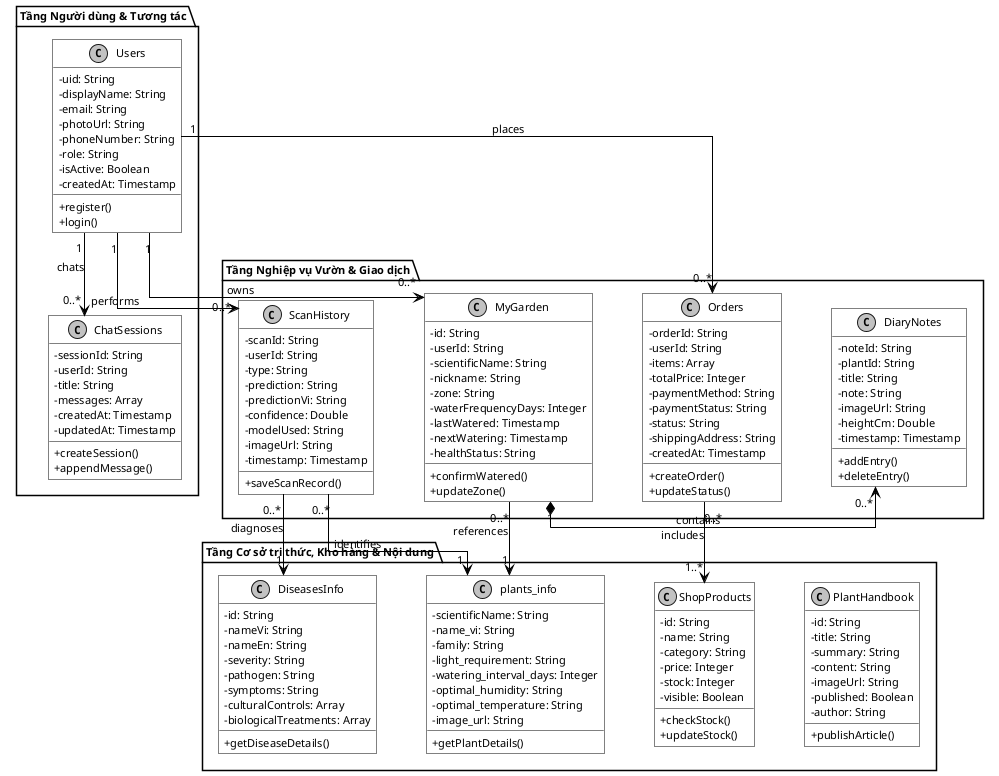

# MÃ NGUỒN PLANTUML BIỂU ĐỒ PHÂN LỚP (HÌNH 2.17)
*(Định dạng: Đen trắng 100%, nét vẽ vuông góc không xiên xéo, bao quát toàn bộ 10 Collection Firebase)*
*(Cách dùng: Vào draw.io -> Arrange -> Insert -> Advanced -> PlantUML -> Dán mã vào)*

