# TỔNG HỢP MÃ NGUỒN PLANTUML CÁC BIỂU ĐỒ TUẦN TỰ (CHUẨN ĐỒ ÁN ĐH VINH)
*(Định dạng đen trắng, nét mảnh, có activation bar, self-call vuông vắn y đúc mẫu baocaoapp.md)*
*(Cách dùng: Vào draw.io -> Arrange -> Insert -> Advanced -> PlantUML -> Dán mã vào)*

---

### Hình 2.5. Biểu đồ tuần tự chức năng đăng ký
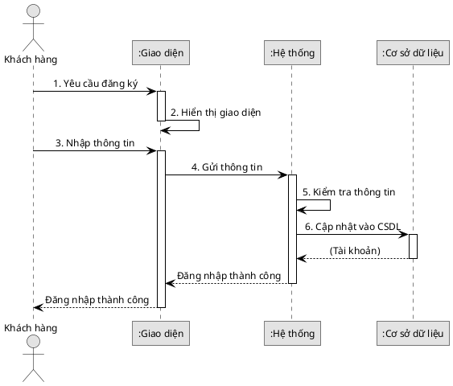

---

### Hình 2.6. Biểu đồ tuần tự chức năng đăng nhập
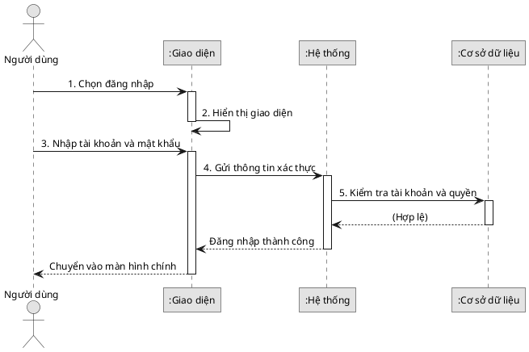

---

### Hình 2.7. Biểu đồ tuần tự chức năng đăng xuất
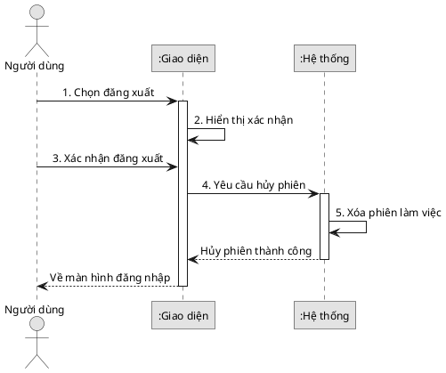

---

### Hình 2.8. Biểu đồ tuần tự chức năng nhận diện loài cây và chẩn đoán bệnh
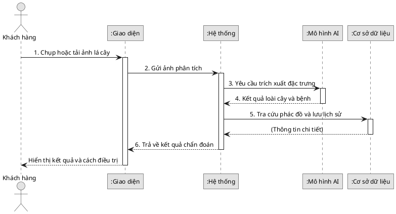

---

### Hình 2.9. Biểu đồ tuần tự chức năng quản lý khu vườn cá nhân
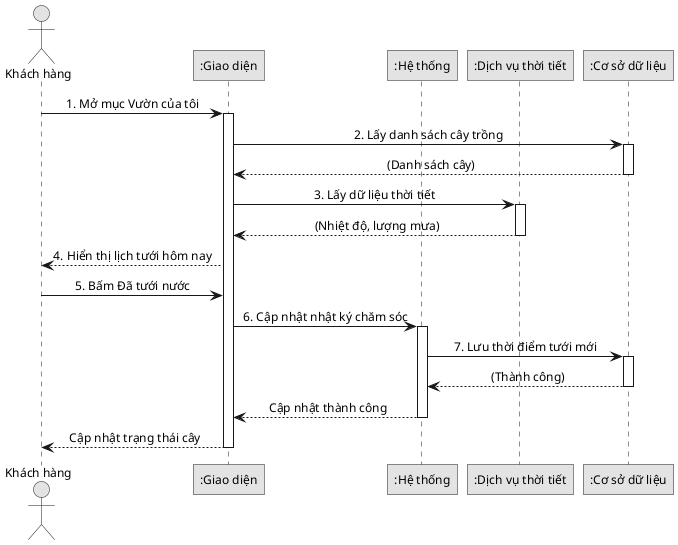

---

### Hình 2.10. Biểu đồ tuần tự chức năng tương tác trợ lý ảo AI
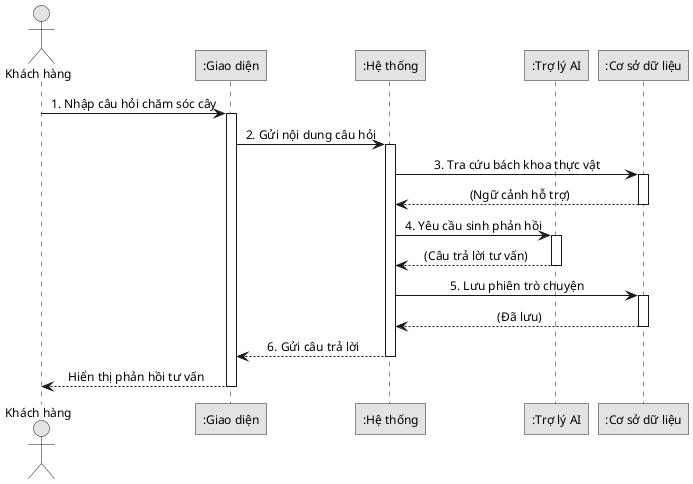

---

### Hình 2.11. Biểu đồ tuần tự chức năng đặt hàng và thanh toán
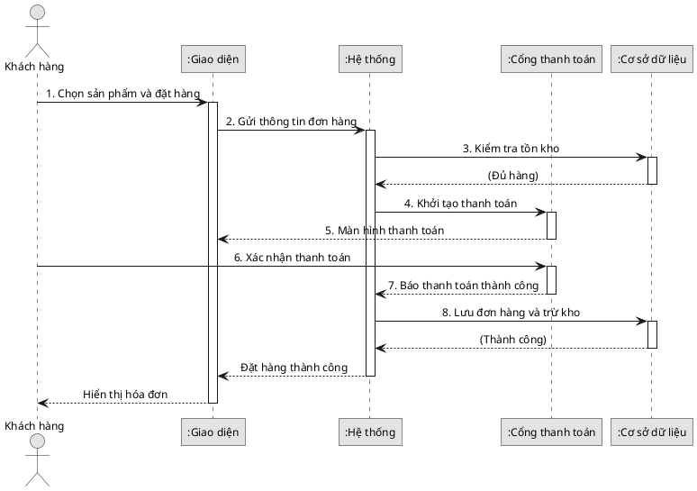

---

### Hình 2.12. Biểu đồ tuần tự chức năng quản lý đơn hàng
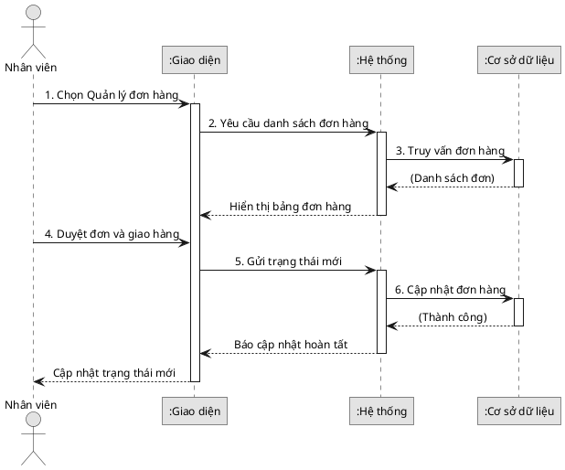

---

### Hình 2.13. Biểu đồ tuần tự chức năng quản lý sản phẩm và kho hàng
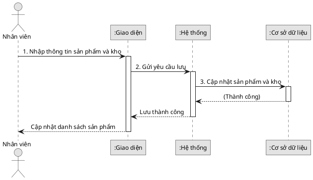

---

### Hình 2.14. Biểu đồ tuần tự chức năng quản lý từ điển thực vật và bệnh học
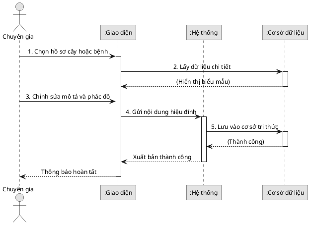

---

### Hình 2.15. Biểu đồ tuần tự chức năng duyệt nhãn dữ liệu AI Lab
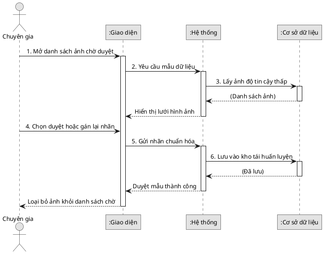

---

### Hình 2.16. Biểu đồ tuần tự chức năng quản lý người dùng và phân quyền
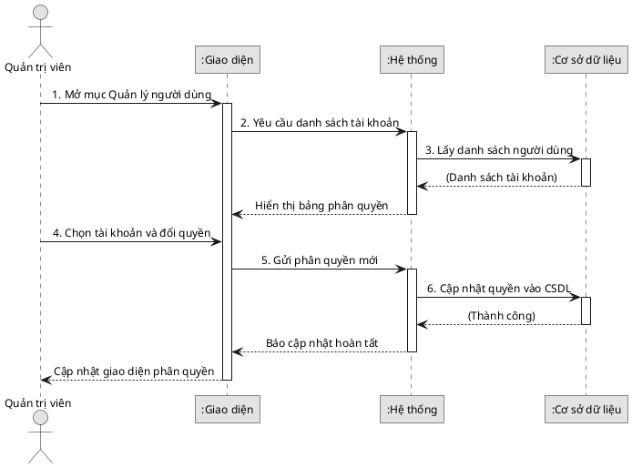

---
